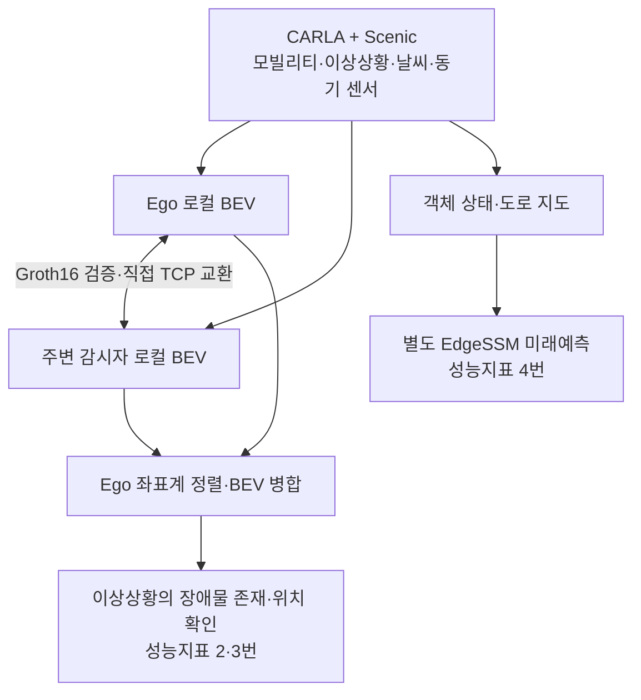

# DAMOS

자동차·휴머노이드·배달로봇이 인지 정보를 직접 공유해, 개별 센서에 가려진 이상상황을 확인하는 협력 시뮬레이션 시스템.

- 환경: CARLA 0.9.16 + Scenic, Town10HD_Opt.
- 기준일: 2026-10-31.
- 프로젝트 방향: [Notion SDV / DAMOS](https://www.notion.so/32d7d69010ae805b8b88c6175f5d9898).
- 현재 수치는 내부 검증·제출 메타데이터 기준. 기관 발급 성적서와 구분.

## 시스템 구성

**현재 시점 협력 인지:**

- 각 노드 입력: RGB 6방향 × 과거 4프레임 + 현재 일반 LiDAR 1프레임.
- 노드별 BEV 생성 → ZKP 증명·공유 → 수신 검증 → Ego 기준 병합.
- 공유 대상: 기본 반경 60m 이내 감시자. 감시자끼리 통신 제외.
- 감시자: 앵커마다 인도에 1대 배치, 상황 방향 감시. 휴머노이드·배달로봇 중 랜덤 선택.

**미래예측:**

- 객체 상태·도로 지도 기반의 별도 EdgeSSM 경로.
- 미래 궤적 6초, 점유 영역 5초.
- 현재 협력 병합 BEV를 입력으로 사용하는 경로는 아님.

센서 규격·모델 입력·공유 메시지·모듈별 구현: [시스템 상세](docs/system.md).

## 성능지표

| 지표 | 내부 검증 결과 | 상태 |
|---|---|---|
| 1. 협력 모빌리티·데이터셋 | 3종 구동·수집 지원. 동시 대수·상호관측·200GB 최종 집계 미확정 | 부분 완료 |
| 2. 개별 모빌리티 처리속도 | 135/135회 정상 완료, 최대 **1.911553289초**. 18초 이하 | ✅ 내부 검증·메타데이터 완료 |
| 3. 이상상황 탐지정확도 | 100건 중 97건 성공, **97%**. 목표 70% 이상 | ✅ 내부 검증·메타데이터 완료 |
| 4. 점유 영역 미래예측 | 5,500시점 모두 **5초 지평 충족**, 유효 생성률 100% | ✅ 내부 검증·메타데이터 완료 |

- 2번은 사전 취득 입력의 Ego 처리시간. 센서 취득·초기화·저장·시각화·경로계획 제외.
- 3번은 앵커의 장애물 존재·위치를 0.5초 이상 연속 확인하는 기준.
- 4번은 예측 지평·유효 생성 평가. 예측 정확도 100%를 뜻하지 않음.
- 최신 개발용 개선 검증과 기존 제출 결과 97%는 별도 관리.

시험 환경·판정 기준·개선 검증·원본 위치: [평가와 증빙](docs/evaluation.md).

## 시나리오와 고장 대응

| 구분 | 구성·검증 |
|---|---|
| Scenic 이상상황 | S1~S9 총 9종. 랜덤 최대 3종 동시 실행 |
| 기본 날씨 | low_sun·heavy_rain·dense_fog·wet_night 중 실행당 1개 |
| HW·SW 고장 | F01~F15 총 15종 |
| 고장 대응 | **S5 × 날씨 4 × 고장 15 = 60/60조건 통과** |

- 불량 입력·과거 출력·검증 실패 패킷 배제, 감시자 대체·정지 요구·서비스 복귀 구현.
- 정상 참조는 같은 장면·날씨에서 고장 주입 전 취득한 데이터.
- 전용 고장 대응 시험 결과이며, 모든 시나리오의 탐지정확도 100%를 의미하지 않음.

상황별 객체·앵커: [시나리오 구성](docs/system.md#scenic-이상상황-9종).
고장 15종·판정·대응 결과: [컨설팅 보완 대응](docs/consulting_response.md).

## 현재 진행상황

- ✅ 2차년도 수행내용 통합, 피드백 2·4·5 본문 반영 완료.
- 피드백 1·3: 박준범 작성 대기. 1단계 단계보고서에 반영.
- 성능지표 4번 결과: 메타데이터 확보, 단계보고서 본문 추가 필요.
- 1단계 단계보고서 전체, 기술·PoC 통합보고서 1건, 2단계 연구계획 준비 필요.
- 공인 성적서 발급·기관 접수·정확한 제출 양식 및 마감일은 미확인.

전체 체크표와 확인 근거: [연말 제출 준비 현황](docs/year_end_status.md).

## 문서 안내

| 문서 | 내용 |
|---|---|
| [시스템 상세](docs/system.md) | 전체 구조·센서 입력·노드·역할·코드 및 작업 경로 |
| [사용법](docs/usage.md) | 새 장비 설정·가상환경·실행·카메라·영상·재검증 |
| [평가와 증빙](docs/evaluation.md) | 성능지표·계측 구간·검증 결과·데이터 및 ZIP 위치 |
| [컨설팅 보완 대응](docs/consulting_response.md) | 고장별 규칙·실패 원인·개선 검증·피드백 대응 |
| [연말 제출 준비 현황](docs/year_end_status.md) | 단계보고서·기술/PoC·2단계 계획·성과 증빙 체크표 |
| [2026-10-30 회의](docs/meeting_261030.md) | 교수님 회의 내용·후속 작업 |

전체 CARLA/Unreal·커스텀 assets·가중치·환경은 별도 필요. Git clone만으로 실행되지 않음. [설치 안내](docs/usage.md#새-컴퓨터-설정) 참조.
