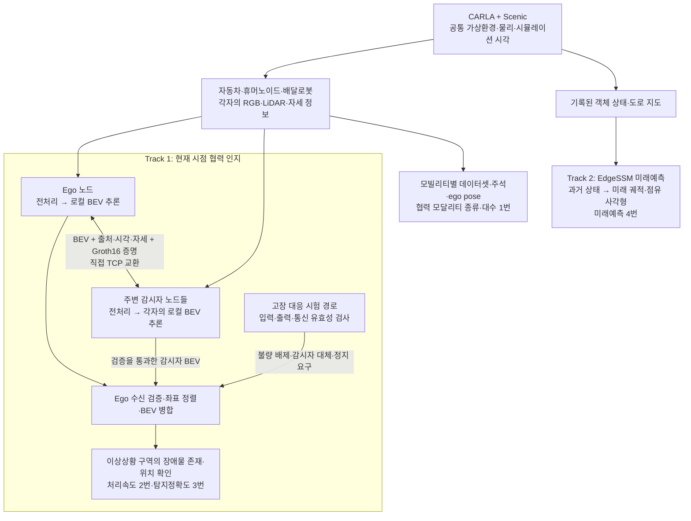

# DAMOS

**DAMOS(Decentralized Autonomous Mobility Simulation):**

- 자동차·휴머노이드·배달로봇이 각자의 인지 정보를 직접 공유하는 시뮬레이션 시스템.
- 개별 모빌리티의 시야에 가려진 이상상황을 협력으로 확인.

**저장소 범위:**

- CARLA/Scenic 환경과 모빌리티·센서 배치.
- 개별 BEV 인지, ZKP 통신, Ego 기준 병합.
- 고장 대응 및 평가를 연결하는 통합 실행 코드.
- 프로젝트 전체에는 별도의 미래 궤적·점유 영역 예측 경로도 포함.
- 모든 기능이 하나의 모델 또는 하나의 평가 루프로 구현된 것은 아님.

**작성 기준:**

- 기준일: 2026-10-31.
- 목표 설계·역할: [Notion SDV / DAMOS](https://www.notion.so/32d7d69010ae805b8b88c6175f5d9898).
- 구현: 현재 코드.
- 평가 수치·기준: 시험신청서와 제출 메타데이터.

## 전체 시스템 구성



**실행 구성:**

- 메인 시스템: 가상 세계·공통 시각·실행 순서·노드 등록 관리.
- 인지 데이터: 별도 중앙 인지 서버를 거치지 않는 노드 간 직접 통신.
- 현재 검증 배치: **한 호스트의 독립 프로세스·공유 GPU·TCP loopback**.
- 실제 다중 PC·무선망 배치와 구분.

### Track 1: 개별 인지에서 협력 탐지까지

**환경 생성:**

- CARLA Town10HD_Opt에서 Scenic이 Ego와 이상상황 객체 생성.
- 일반 주행 Ego는 빨간 `vehicle.ford.mustang` 1대.
- 일반 주행에서는 autopilot 사용.

**감시자 배치:**

- 이상상황의 개별 객체 또는 군집을 앵커로 정의.
- 앵커마다 감시자 1대를 인도에 배치, 해당 상황 방향으로 고정.
- 휴머노이드·배달로봇 중 랜덤 선택.

**동기 입력 구성:**

- 각 노드의 RGB 6방향 × 과거 4프레임 취득.
- 현재 일반 LiDAR 1프레임 취득.
- 센서 간·노드 간 공통 프레임 사용.
- 장착 위치, 카메라 내·외부 파라미터, 자세를 함께 구성.

**개별 BEV 추론:**

- 각 노드가 자신의 입력으로 추론 수행.
- 출력: 17종 클래스 확률과 관측 마스크.
- 범위: 노드 중심 80m × 80m.
- 격자: 200 × 200셀, 셀 크기 0.4m.

**증명·공유:**

- Ego와 기본 반경 60m 이내 감시자가 직접 교환.
- 공유 내용: BEV 확률·관측 마스크·자세·프레임·시각·모델 식별정보.
- 실제 Groth16 증명 사용.
- 감시자끼리 통신은 제외.

**검증·병합:**

- 등록 송신자·본문 해시·증명 검사.
- 회차·시각·모델 일치 여부 검사.
- 통과한 BEV만 자세 변환으로 Ego 좌표계에 정렬.
- 관측·신뢰도 기준으로 병합.
- 선택 기능 `relative-v3`: Ego의 불확실한 지면 판정을 더 강한 감시자 관측으로 보완.
- 희소 LiDAR 구조 복원과 고신뢰 감시자 반영 유지. 추가 관측은 Ego 지면 점수와 비교해 수용.
- 기본값 `off`. 활성화·검증 범위는 [사용법](docs/usage.md#상대-신뢰도-병합-옵션) 참조.

**존재·위치 확인:**

- 병합 결과를 장애물·지면·미관측으로 해석.
- Scenic 이상상황 구역의 장애물 존재·위치 평가.
- 세부 객체 종류·행동 분류와 구분.

**LiDAR 역할:**

- 단순 표시용이 아닌 모델의 공간·높이·관측 범위 입력.
- RGB와 함께 인지에 사용.
- 일반 LiDAR의 지면 형상은 도로 오탐 보정에도 사용.
- **미관측 셀은 빈 공간으로 간주하지 않음.**

**실시간 처리 방식:**

- Scenic이 진행되는 동안 모델 처리 수행.
- 처리 완료 후 최신 공통 입력으로 다음 회차 시작.
- 모든 시뮬레이션 tick의 추론을 보장하는 방식은 아님.
- 영상 FPS와 모델 처리 횟수는 별개.

### Track 2: 미래 궤적·점유 영역 예측

**입력·모델:**

- 입력: CARLA에서 기록한 객체 상태와 도로 지도.
- 관측창: 현재 포함 과거 50스텝, 0.1초 간격.
- 모델: EdgeSSM.
- 대상: 자동차·보행자·오토바이·자전거.

**출력:**

- 객체별 6개 모드의 미래 중심 궤적.
- 궤적 범위: 60스텝·6초.
- 점유 사각형 범위: 최초 50스텝·5초.
- 점유 사각형은 예측 위치·방향·실측 크기로 구성.

**평가·자료:**

- 협력 인지와 구분되는 별도 모델·입력·평가 경로.
- 데이터 취득 후 오프라인 추론.
- 미래 정답은 입력에서 제외, 오차 계산에만 사용.
- `4번항목_메타데이터.zip`에 모델·소스·지도·취득 상태·예측·검증 도구 보존.

**목표 설계와 현재 연결 범위:**

- Notion 목표: RGB 6방향 × 6프레임 기반 미래 점유 예측·공유.
- 현재 Track 1: 전달 모델에 맞춘 4프레임·현재 BEV 경로.
- 현재 Track 2: 상태·지도 기반 미래예측 경로.
- Track 2는 현재 Track 1 병합 BEV를 입력으로 사용하지 않음.
- Track 2의 미래예측은 18초 계측에 미포함.
- Track 2의 5초 목표 충족과 Track 1의 미래 BEV 공유 구현 완료는 별개.

## 서브시스템별 구현·해결 방식

코드 경로 기준: `Carla-0.9.16-source/_DAMOS/scripts/`.

**시뮬레이션 통합:**

- 문제: CARLA·Scenic·후속 노드의 실행 순서와 시계 충돌.
- 서버 준비 → Scenic Ego/객체 생성 완료 확인 → 감시자·센서 부착.
- Scenic 외부에서 임의 tick 진행 금지.
- 코드: `run_scenic_custom_walkers_town10hd.sh`, `scenic_custom_walker_injector.py`.

**이상상황·앵커:**

- 문제: 객체 수와 감시 지점 혼동, 잘못된 객체 재선택.
- S1~S4는 개별 객체 단위.
- S5~S9는 의미 있는 구역·군집 단위.
- 원래 Scenic actor ID와 구성 객체 유지.
- 코드: `scenic_custom_walker_injector.py`.

**커스텀 모빌리티:**

- 문제: 로봇 외형·보행자 기반 동작·카메라 가시성 연결.
- CARLA Unreal 소스에 custom walker factory·pose·visibility 컴포넌트 추가.
- 센서 영상까지 정지하던 가시성 전파 수정·모듈 재빌드.
- 코드: `custom_walker_runtime.py`, [Unreal overlay](Carla-0.9.16-source/Unreal/CarlaUE4/Plugins/Carla/Source/Carla/Damos/).

**센서·동기화:**

- 문제: 모빌리티별 장착 차이, 다른 프레임·보정값 혼합.
- RGB 6개+일반 LiDAR 1개, 공통 4프레임 버퍼 사용.
- CARLA 좌표계 변환·카메라 보정·전처리 적용.
- 코드: `bev_sensor_rig.py`.
- 장착 기준: [sensor_config.txt](sensor_config.txt).

**개별 인지:**

- 문제: 전달 모델을 실제 센서 입력에 연결.
- 입력 shape·taxonomy·가중치 strict load·학습 step 유지.
- 실제 CUDA 추론 후 확률·관측 마스크·자세 반환.
- 코드: `bev_model_runtime.py`.

**도로 오탐 보정:**

- 문제: 도로가 장애물로 보이며 대상 구역 확인 방해.
- 일반 LiDAR 지면 평면·높이·구조 주변 보존을 이용한 보정.
- 고정 체크포인트로 관리.
- 평가 정답을 실행 입력으로 사용하지 않음.
- 코드: `bev_lidar_calibration.py`, `bev_ground_guard.py`.

**ZKP·M2X 공유:**

- 문제: 발신자 확인, 본문 변조·과거 패킷·잘못된 증명 배제.
- 제공 DAMOS_zkp 회로·키·WASM으로 실제 Groth16 사용.
- BEV 패킷 adapter로 현재 메시지 연결.
- 본문 해시·수신자·세션·회차·시각·모델을 결합·검증.
- 코드: `m2x/security.py`, `bev_protocol.py`, `bev_mesh.py`.

**Ego 기준 병합:**

- 문제: 서로 다른 위치·방향의 BEV를 같은 지도에서 해석.
- 자세 기반 inverse warp 적용.
- 유효 관측과 신뢰도로 병합.
- 감시자로 추가된 관측 셀·기여 출처 보존.
- 선택적 보완: 높은 위치의 단일 LiDAR 반환을 인접 구조와 함께 확인해 복원.
- 점수 0.50 이상 0.60 미만 감시자 관측은 Ego가 관측한 지면 점수보다 높은 경우에만 추가 반영.
- 검증을 통과한 관측과 보행자·자전거 출력, 주변 장애물 근거 사용. 기존 장애물 탐지 유지.
- 코드: `bev_fusion.py`, `bev_evidence_correction.py`, `bev_relative_fusion.py`, `bev_occupancy.py`.

**고장 대응:**

- 문제: 불량 입력·묵은 출력·수신 실패 정보의 병합 방지.
- 데이터 기반 유효성 검사.
- 감시자 대체 또는 정지 요구.
- 정상 3회 연속 확인 후 서비스 복귀.
- 코드: `bev_fault_quality.py`, `bev_resilience.py`.

**평가·증빙:**

- 문제: 생성 객체·예측·캡처 불일치, 재현 불가능한 수치.
- 동일 actor·프레임·시각의 정답 대조.
- 코드/입력 해시·실제 증명·병합·상태 사후 감사.
- 코드: `bev_anchor_evaluation.py`, `audit_carla_resilience.py`.

**시각화:**

- 문제: 서로 다른 시점 영상, LiDAR 간격과 예측의 혼동.
- 같은 프레임의 Ego/감시자/병합 BEV와 RGB를 2×3으로 구성.
- 화면용 보간·GT 윤곽·EGO 표식은 공유·평가 입력에서 제외.
- 코드: `bev_passby_video.py`, `bev_video_render.py`.

**ZKP 검증 범위:**

- 등록 송신자와 전달 메시지의 결합·무결성 확인.
- 모델 실행·인지 정확도·센서 내용의 현실적 진실성·암호화는 증명하지 않음.
- 현재 신뢰된 로컬 등록·직접 TCP prototype.
- 외부망용 보안 배포와 구분.

## 성능지표별 달성 방식·결과

- 현재 시험신청서의 네 항목 기준.
- **내부 검증·제출자료 기준**이며 기관 발급 성적서와 구분.
- 서로 다른 지표의 시험 건수·환경을 합산하지 않음.

| 지표 | 목표 | 확인된 결과 |
|---|---|---|
| 1. DAMOS 협력 모달리티 종류 및 대수 | 3종 이내·3대 이상, 데이터 200GB 이상 | 3종 구동·수집 지원, 최종 정량 집계 미확정 |
| 2. 개별 모빌리티 시스템 시뮬레이션 처리속도 | 전체 처리 정상 완료, 최대 18초 이하 | **135/135 완료, 최대 1.911553289초**. 목표 충족 |
| 3. 복합 모빌리티 환경 이상상황 탐지 시 객체 인식 및 탐지정확도 | 앵커 연속 탐지 성공률 70% 이상 | **97/100 성공, 97%**. 목표 충족 |
| 4. 주행 관심 지역 점유 영역 미래예측 | 전 평가 시점 지평 5초 이상, 유효 생성률 95% 이상 | **5,500/5,500시점 충족, 유효 생성률 100%**. 제출자료 자체 기준 충족 |

### 1번: 모빌리티 종류·대수와 데이터셋

**구현·입증 방법:**

- 자동차·휴머노이드·배달로봇 3종 구동·센서 수집 지원.
- 모빌리티별 독립 데이터셋 사용.
- category·시각·3차원 좌표·ego pose 교차 검증.
- 신청서의 교차 관측·종류·대수·용량 판정은 기존 데이터셋 대상으로 별도 집계.

**확인된 범위:**

- 기존 공유 데이터셋 위치 확인.
- 종류·동시 대수·용량·상호관측의 최종 정량 집계는 이 저장소에서 미확정.
- 세 모빌리티 지원과 특정 실행에서 세 종류의 동시 관측 증빙은 별개.
- Ego+감시자 1대인 장면만으로 3종 충족을 주장하지 않음.
- 데이터 위치: `\\1.233.219.109\Storage\Data\Carla\Columbus\Dataset\2026`.

### 2번: 18초 처리시간

**계측 구간:**

- 시작: 원시 RGB·LiDAR 메모리 준비 후 worker IPC 전달 직전.
- 종료: Ego 병합·장애물 존재·위치 확인 결과 생성 완료.
- 포함: 개별 추론·ZKP 교환/검증·병합·장애물 존재 판정.
- 시간 기준: 공통 `perf_counter_ns`의 실제 경과시간.
- 제외: CARLA 취득·파일 읽기/디코딩·초기화·워밍업.
- 제외: 저장·시각화·사후 감사·경로계획.

**입력·반복:**

- S1~S9 입력 9식.
- 입력별 처리 세션 3회 × 세션당 5회, 각 15회.
- 총 135회는 동일 입력 반복 처리 횟수.
- 독립 장면 135건이 아님.

**환경·결과:**

- Goosebump: Ubuntu 24.04, Ryzen 9 9950X, RTX 5090.
- Ego+감시자 1대의 독립 프로세스·TCP loopback 조건.
- **135/135 정상 완료, 최대 1.911553289초, 평균 1.448647846초.**
- 최대 18초 이하 목표 충족.
- 다른 GPU·무선망·모든 모빌리티에 동일 시간을 보장하는 수치는 아님.

### 3번: 이상상황 탐지정확도

**평가 단위·대상:**

- 신규 장면의 사전 지정 앵커 1곳이 시험 1건.
- S1~S8 각 11건, S9 12건, 총 100건.
- 평가 대상: **이상상황의 장애물 존재·위치**.
- 세부 객체 종류·행동 분류와 구분.

**프레임 탐지 조건:**

- Ego가 차도에 위치.
- 앵커가 80m × 80m 평가 범위 안에 위치.
- 정답 영역 3셀 이상 확보.
- 정답과 겹치는 예측 장애물 셀 3개 이상이 8방향으로 연결.

**앵커 성공 조건:**

- 탐지가 **0.5초 이상 연속** 확인되면 성공.
- 미탐지·자료 누락·정답 부족·범위/차도 이탈 시 연속 구간 종료.
- 성공 앵커 수 ÷ 전체 100건으로 성공률 산출.

**결과·증빙:**

- **정상 평가 100건 중 97건 성공, 성공률 97%.**
- 탐지 실패 3건: S1 1건·S3 2건. 연속 탐지 약 0.4초로 기준 0.5초 미달.
- 실행 오류 7건은 원래 seed·날씨·Ego 시작 위치·판정 기준으로 재평가 완료. 미완료 실행 오류 0건.
- 기존 정상 평가 93건과 최초 실행 오류 기록 보존.
- 619개 판정 샘플은 추가 시험 건수로 미산입.
- vvu에서 취득·처리.
- 평가 GT는 같은 actor·시각의 정답 대조 전용.
- GT는 모델·공유·병합 입력과 분리.

### 10월 31일 추가 개선 검증

**실제 탐지 실패 개선:**

- 원 제출 평가에서 연속 탐지 0.4초로 미달한 3건의 원인 분석.
- 희소 LiDAR 관측 배제와 Ego 지면 우선 병합에 의한 미탐지 보완.
- 추가 S1 미달 장면: 감시자 수용에 상대 신뢰도 비교를 적용해 0.4초에서 0.6초로 회복.

| 구분 | 확인 결과 |
|---|---|
| 저장 개발 자료 122건·1,279샘플 | 이전 보완 121건 → 새 보완 122건 기준 충족. 기존 성공 손실 없음 |
| 새 시드 S1·S3 4조건 | 실제 모델·Groth16·새 병합으로 4/4건 기준 충족. 같은 입력의 원본 병합은 2/4건 |
| 추가 보정 포함 Ego 처리 | 이번 120개 처리 샘플 최대 1.520368336초. 모두 18초 이내 |
| 저장 자료 지면 오탐 보조 진단 | 이전 보완 3.8047% → 새 보완 3.8085%, 약 0.0037%p 증가 |

- 성공 기준은 연결 장애물 격자 3칸 이상·0.5초 이상 연속 탐지로 유지.
- 저장 자료 재처리는 개발 검증. 기존 제출 결과 **97/100·97%**를 대체하지 않음.
- 새 시험은 S1·S3의 어린이 3개 모델과 네 날씨의 지정 4조건. 모든 조합 검증은 아님.
- 일반 BEV 공유의 Ego 병합에 옵션으로 연결. 고장 대응 서비스 경로는 변경하지 않음.
- 보고서 반영 완료. 현재 목차·담당 상태는 [컨설팅 피드백 대응](#컨설팅-피드백-대응) 참조.
- 상세: [컨설팅 5번 대응](docs/consulting_response.md#5-실패-분석과-변경재검증).

### 4번: 미래예측 지평과 유효 생성

**주행 상황 10식:**

- 직진, 좌회전, 우회전.
- 신호 정지 후 직진, 신호 정지 후 좌회전.
- 감속·재출발 추종, 오토바이 추월.
- 자전거 우회전, 보행자 횡단·차량 양보, 교차 차량 통과.
- S1~S9와 다른 Track 2 주행 시험 묶음.
- 날씨: ClearNoon 고정.

**데이터·입증 방법:**

- 기록한 물리 이동·신호·차로·제어 정보로 10/10 행동 발생 확인.
- 각 상황 65초 취득, 그중 60초를 시험 구간으로 사용.
- 초기 50시점 제외 후 상황당 550시점 평가.
- 총 5,500시점, 각 상황의 객체 8개 대상.
- 뒤 5초는 마지막 시점의 미래 정답 확보용.
- EdgeSSM 궤적·점유 사각형의 지평·유효성·무결성 검증.

**판정·결과:**

- 미래 궤적: 6초.
- 점유 사각형: 5초.
- **공동 평가 지평: 5초.**
- 모든 5,500시점이 지평·유효 생성 기준 충족.
- 유효성 검사: 유한값·시간축·객체 대응·확률·점유 형상·사전 ROI.
- 유효 생성률 100%는 예측 정확도 100%가 아님.
- 참고 오차: minADE 0.303090m, minFDE 0.810073m.
- 참고 오차는 합격 판정에 미사용.

## 이상상황·날씨·고장 시험 구성

### Scenic 이상상황 9종

| ID | 이상상황 | 객체 배치·생성 수 | 앵커 수 |
|---|---|---|---:|
| S1 | 보행자 무단횡단 | 검증된 3구역 안 랜덤, 보행자 3 | 3 |
| S2 | 자전거 무단횡단 | 랜덤 인도 위치, 자전거 3 | 3 |
| S3 | 비가시영역 무단횡단 | 고정, 보행자 3 | 3 |
| S4 | 도로 위 장애물 | 랜덤 차로 위치, 대형 container 4 | 4 |
| S5 | 인도 위 장애물 | 고정, 불법 주차 차량 6 | 1 |
| S6 | 도로 공사·차선 감소 | 고정, barrier/warning 36 | 1 |
| S7 | 인도 공사·통행 불가 | 고정, barrier/warning 40 | 1 |
| S8 | 인도 군중 | 고정 3군집 × 보행자 7, 총 21 | 3 |
| S9 | 인도 쓰레기 더미 | 고정 5군집, trash/bin 40 | 5 |

**앵커·감시자:**

- 앵커: 감시·평가할 지점 또는 구역.
- 앵커 member: 그 상황을 구성하는 원래 객체.
- S1~S4는 개별 객체, S5~S9는 구역·군집 기준.
- 감시자는 앵커당 1대.
- 인도 배치·상황 방향 감시 유지.

**시나리오·날씨 선택:**

- `--n-scenarios 3`: 서로 다른 최대 3종을 **동시에** 실행.
- 한 실행의 날씨: 네 기본 preset 중 하나.
- 기본 preset: `low_sun`, `heavy_rain`, `dense_fog`, `wet_night`.
- 날씨 정의: [공유 JSON](Carla-0.9.16-source/_DAMOS/_scenarios/weather_presets.json).
- 일반 실행: Low 품질.
- 실제 안개·후처리 효과 검증: Epic 품질.

### 고장 대응과 서비스 유지

**고장 종류·실행 경로:**

- F01~F15 총 15종.
- 카메라·LiDAR 이상, 센서 지연, 과거 모델 출력.
- 통신 미수신, 본문 변조·재전송·잘못된 증명, 복합 소실.
- 상세 규칙: [고장 15종](docs/consulting_response.md#고장-15종).
- 고장 대응 상태는 `run_carla_resilience.py`의 전용 시험 경로에서 검증.
- 일반 `--live-bev-fusion` 주행에 안전제어가 항상 자동 연결된다는 의미는 아님.

| 확인 결과 | 대응 |
|---|---|
| 로컬 불량·정상 감시자 정보 확보 | `DEGRADED_COOPERATIVE`: 불량 로컬 BEV 배제·감시자 대체 |
| 유효 감시자 부재·관측 부족·노후 결과 | `SAFE_STOP`: 정지 요구 |
| 정상 데이터 복귀 | `RECOVERING`: 3회 연속 확인 후 `NORMAL` 복귀 |

**상태 판정 범위:**

- 로컬 불량: 센서 입력 또는 모델 출력 사용 불가.
- 품질 비교 기준: 동일 장면·날씨에서 고장 주입 전 취득한 정상 데이터.
- 정상 참조 대비 선명도·점 수, 센서 사양·장착값·프레임·시각·패킷 검증 결과로 판정.
- 불량 데이터는 정상 참조 갱신에서 제외. 장면·날씨가 계속 바뀌는 일반 주행의 자동 진단 성능은 별도 검증 대상.
- 유효 감시자 부재: 미수신 또는 검증 실패.
- 정지 요구 조건은 시험에서 별도 저속 제동 동작 확인.
- 서비스 복귀와 운행 자동 재개 시험은 구분.

**대응 시험 결과:**

- **S5 × 기본 날씨 4 × 고장 15 = 60/60조건 대응 통과.**
- 각 조건: 정상 3회 → 고장 1회 → 복귀 3회.
- 날씨별 새 장면에서 15종을 순차 주입.
- 모든 S1~S9 조합을 시험한 것은 아님.

**F09 출력 최신성 검사:**

- 출력의 회차·프레임·수집시각·추론 완료 기록으로 과거 결과 자동 배제.
- 과거 결과는 송신·병합에서 제외하고 검증된 감시자 BEV로 대체.
- 네 날씨 4/4조건 별도 검증.
- 기존 60조건 원본 보존.

**결과 해석:**

- 배제·대체·정지 요구·복귀 동작 확인.
- **고장 중 장애물 탐지정확도 100%를 뜻하지 않음.**
- 15종 원인의 완전 자동 진단을 뜻하지 않음.
- 결과 미반환·OS 프로세스 정지·실차 안전전환은 별도 범위.

## 컨설팅 피드백 대응

**정리 기준:**

- 컨설팅 의견을 묶은 1~5번. 성능지표 번호와 구분.
- 1단계 구현·검증 및 보고서 반영 내용과 2단계 후속 계획 분리.
- 상세 기준·실패 원인·증빙: [컨설팅 보완 대응](docs/consulting_response.md#컨설팅-보완-대응).

| 번호 | 보완 요청 | 현재 대응·반영 위치 | 후속 작업 |
|---|---|---|---|
| 1 | 장기 미래예측의 상세 목표·실제 적용 문제 구체화 | 1차년도 장기예측 절의 보완 대상. 박준범 작성 대기 | 목표의 의미·필요성·적용 문제와 대응 근거 작성. 10초 목표와 실제 성과 구분 |
| 2 | “지속적인 강건한 서비스”의 정의·검증 전략 보강 | 정상 참조·유효성 검사, 감시자 대체·정지·복귀 구현. 보고서 서브시스템2 마지막 다항 반영 | 실모빌리티의 장시간 서비스 유지·전환 검증 |
| 3 | 10초 예측 관련 최신 기술·추가 개발기술 제시 | 기존 PPT의 검토 후보·적용·비교평가안 보존. 박준범 작성 대기 | 1차년도 장기예측 절에 보완 설명. 확정한 후속 계획만 2단계 제안서와 연결 |
| 4 | 악천후·단절·악성 정보·복합 고장의 안전전환 기준 보강 | CARLA S5 60/60조건 대응·복귀, 별도 제동 20/20 확인. 보고서 서브시스템2 마지막 다항 반영 | 실모빌리티·실도로·실제 통신환경 검증 |
| 5 | 실패 상황·원인·알고리즘 변경·재검증 결과 제시 | 실제 실패 분석·병합 개선·122건 재검사·새 4조건 검증. 보고서 3-2 마지막 사항 반영 | 자연 주행 안전 영향 추가 검증 |

**현재 완료 범위:**

- 2·4·5번: CARLA 구현·검증 및 한글 보고서 반영 완료. 대응 내용은 각 담당 시스템의 마지막 항목에 통합.
- 3-2의 별도 아·자 항목과 중복 표 15 정리. 기존 성능지표·표 1~14·그림 1~23 유지.
- 1·3번: 박준범 작성 대기. 1단계 보고서의 1차년도 서브시스템3 마지막 항목에 장기예측 보완 설명 추가 권장. 10초 달성·최신 기술 적용 완료로 미표기.
- 60조건 고장 대응 결과와 100건 탐지 성공률은 서로 다른 시험.

## 역할 분담·통합 경계

- Notion의 역할 분담 기준.
- 원 개발 담당과 이 저장소의 환경 적응·통합·검증 작업을 구분.

| 원 개발 영역 | 담당 |
|---|---|
| 시뮬레이션·센서·시스템 연결 | 김기웅 |
| Scenic 이상상황 | 손유정 |
| 커스텀 모델·데이터셋 | 박형빈 |
| 영지식 M2X | 경다녕·이서희·염주현 |
| 인지·융합 | 이예린·이성규 |
| 미래 궤적·점유 예측 | 박준범 |

**현재 통합 경계:**

- 시뮬레이션: 실행 오케스트레이션, 모빌리티·센서 배치, 인지·통신 연결, 2·3번 평가.
- Scenic: S1~S9 정의를 현재 앵커·감시·동시 실행 방식에 적용.
- 커스텀 모델: 휴머노이드·배달로봇 외형과 CARLA walker·센서 연결.
- M2X: 제공 Groth16 구현을 현재 BEV 메시지·수신 검증에 연결.
- 인지·융합: 제공 모델의 입력 적응, Ego 좌표 정렬·병합, 존재·위치 평가.
- 미래예측: Track 2 상태·지도 입력 경로, 4번 제출 패키지로 관리.

## 코드·실행·증빙 위치

**저장소 성격:**

- `/home/vvu/vv/DAMOS`와 같은 상대 경로의 **source overlay**.
- 전체 CARLA/Unreal·Scenic checkout·커스텀 assets는 별도 필요.
- 가중치·가상환경·데이터셋도 별도 필요.
- clone만으로 실행 불가.

```text
STL_DAMOS/
├── README.md                         # 전체 시스템·서브시스템·평가지표
├── sensor_config.txt                 # 모빌리티별 센서 장착 기준
├── docs/
│   ├── usage.md                      # 설치·실행·카메라·재검증
│   └── consulting_response.md        # 고장별 규칙·시험 근거·한계
├── Carla-0.9.16-source/
│   ├── _DAMOS/
│   │   ├── _scenarios/               # Scenic S1~S9·공유 날씨
│   │   ├── scripts/                  # 센서·인지·공유·병합·평가
│   │   ├── tests/                    # 회귀시험
│   │   └── vendor/                   # 제공 BEV·ZKP 구현
│   ├── Scenic/Maps/                  # 도로 네트워크
│   └── Unreal/CarlaUE4/Plugins/Carla/Source/Carla/Damos/
├── UnrealEngine_4.26/README.md
└── archive/
```

**작업·보존 위치:**

- 주작업 루트: `/home/vvu/vv/DAMOS`.
- 명령 실행 위치: `Carla-0.9.16-source`.
- Git mirror: `_git/STL_DAMOS`.
- 원시 입력·BEV·로그·영상·시험 원본은 Git에 미업로드.
- Track 2 모델·실행 소스는 별도 제출 패키지에 포함.
- Track 2를 이 트리의 BEV 모듈로 간주하지 않음.

### 빠른 확인

- vvu에 준비된 환경 기준.
- S5 단독으로 실제 BEV 추론·ZKP 공유·병합·평가 실행.
- 새 장비는 [환경 설치](docs/usage.md#새-컴퓨터-설정)부터 확인.

```bash
cd /home/vvu/vv/DAMOS/Carla-0.9.16-source

env DAMOS_BEV_CHECKPOINT=/home/vvu/vv/DAMOS/Carla-0.9.16-source/_DAMOS/models/yerin_bev/scenic_presence_ground_guard_20261008.pt \
  _DAMOS/scripts/run_scenic_custom_walkers_town10hd.sh \
  --restart --offscreen --port 2620 --selected-scenario S5 \
  --runs 1 --scenic-time 30 --realtime-factor 1.0 \
  --quality-level Epic \
  --live-bev-fusion --bev-rounds 3 --bev-radius-m 60 \
  --evaluate-bev --no-trajectory-report
```

**결과·모드:**

- 기본 결과: `_DAMOS/reports/live_bev_*/`.
- 로그: `_DAMOS/logs/`.
- `--live-bev-fusion`: 현재 인지·BEV 공유 경로.
- `--live-ego-sharing`: 이전 정면 이미지 1장 공유 경로.
- 두 모드 동시 사용 불가.

### 평가·공유 자료

**1번 기존 데이터셋:**

- `\\1.233.219.109\Storage\Data\Carla\Columbus\Dataset\2026`.

**시험신청서·2/3/4번 제출 ZIP:**

- 공유 폴더: `1단계-2차년도[2026]/공인인증평가/`.
- `2번항목_메타데이터.zip`.
- `3번항목_메타데이터.zip`.
- `4번항목_메타데이터.zip`.

**2·3번 재계산:**

- 각 ZIP에 검증 도구 동봉.
- [검증과 공유](docs/usage.md#검증과-공유) 참조.

**4번 모델·결과·도구:**

- 조건: `protocol.json`.
- 모델·소스: `models/`, `source/`, `source_runtime/`.
- 분석 결과: `analysis/`.
- 저장 결과 검증: `source/verify_metric4.py --root .`.
- 주행 행동 검증: `source/verify_scenarios.py --root .`.

**고장 대응 원본:**

- `/home/vvu/vv/_Data/Carla/Columbus/DAMOS_results/`.
- 세부 경로·감사 파일: [증빙 위치](docs/consulting_response.md#증빙-위치).

**문서 역할·원본 보존:**

- [사용법](docs/usage.md): 설치·운영.
- [검증 기술문서](docs/consulting_response.md): 판정·실패·한계·증빙.
- [런타임 안내](Carla-0.9.16-source/_DAMOS/README.md): 내부 경로.
- 기존 실패 기록·원본 actor/시각 대응·제출 ZIP을 결과에 맞춰 덮어쓰지 않음.
