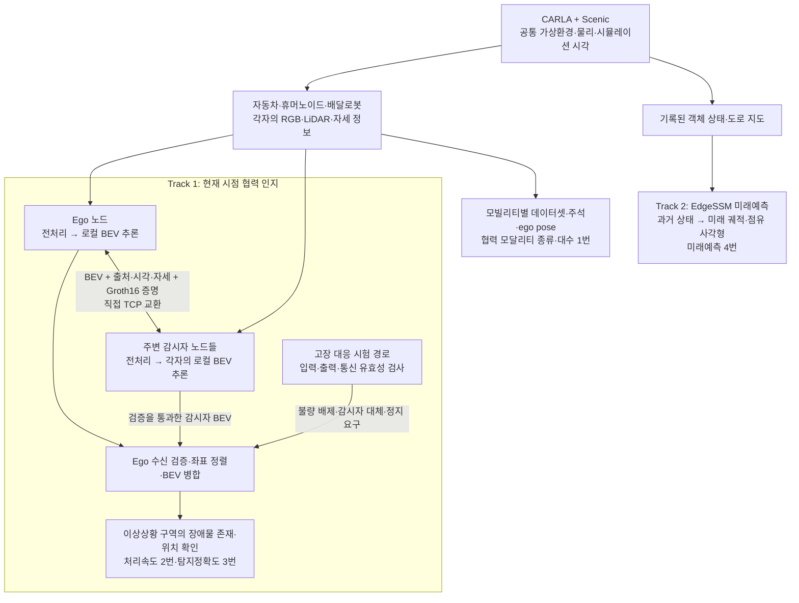

# DAMOS

**DAMOS(Decentralized Autonomous Mobility Simulation)는 자동차·휴머노이드·배달로봇이 각자의 인지 정보를 직접 공유해, 개별 모빌리티의 시야에 가려진 이상상황을 협력으로 확인하는 시뮬레이션 시스템.**

이 저장소는 CARLA/Scenic 환경, 모빌리티·센서 배치, 개별 BEV 인지, ZKP 통신, Ego 기준 병합, 고장 대응 및 평가를 연결하는 통합 실행 코드. 프로젝트 전체에는 이 협력 인지 경로와 별도로 미래 궤적·점유 영역 예측 경로도 포함.

기준일: 2026-10-26. 목표 설계·역할은 [Notion SDV / DAMOS](https://www.notion.so/32d7d69010ae805b8b88c6175f5d9898), 구현은 현재 코드, 평가 수치·기준은 시험신청서와 제출 메타데이터 기준. **모든 기능이 하나의 모델 또는 하나의 평가 루프로 구현된 것은 아님.**

## 전체 시스템 구성



메인 시스템은 가상 세계·공통 시각·실행 순서와 노드 등록 관리. 인지 데이터 교환은 별도 중앙 인지 서버를 거치지 않는 노드 간 직접 통신. 현재 검증 배치는 **한 호스트의 독립 프로세스·공유 GPU·TCP loopback**이며 실제 다중 PC·무선망 배치와 구분.

### Track 1: 개별 인지에서 협력 탐지까지

1. **환경 생성:** CARLA Town10HD_Opt에서 Scenic이 Ego와 이상상황 객체 생성. 일반 주행 Ego는 빨간 `vehicle.ford.mustang` 1대, autopilot 사용.
2. **감시자 배치:** 이상상황의 개별 객체 또는 군집을 앵커로 정의. 앵커마다 감시자 1대를 인도에 배치, 해당 상황 방향으로 고정. 휴머노이드·배달로봇 중 랜덤 선택.
3. **동기 입력 구성:** 각 노드의 RGB 6방향 × 과거 4프레임과 현재 일반 LiDAR 1프레임 취득. 센서 간·노드 간 공통 프레임, 장착 위치, 카메라 내·외부 파라미터 및 자세를 함께 구성.
4. **개별 BEV 추론:** 각 노드가 자신의 입력으로 17종 클래스 확률과 관측 마스크 생성. 격자는 노드 중심 80m × 80m, 200 × 200셀, 셀 크기 0.4m.
5. **증명·공유:** Ego와 기본 반경 60m 이내 감시자가 BEV 확률·관측 마스크·자세·프레임·시각·모델 식별정보를 실제 Groth16 증명과 함께 직접 교환. 감시자끼리 통신은 제외.
6. **검증·병합:** 등록 송신자·본문 해시·증명·회차·시각·모델 일치를 검사. 통과한 BEV만 자세 변환으로 Ego 좌표계에 정렬하고 관측·신뢰도 기준 병합.
7. **존재·위치 확인:** 병합 결과를 장애물·지면·미관측으로 해석. 세부 객체 종류나 행동 분류보다 Scenic 이상상황 구역에 장애물이 있는지와 그 위치를 평가.

LiDAR는 단순 표시용이 아니라 모델의 공간·높이·관측 범위 입력. RGB와 함께 인지에 사용하며, 일반 LiDAR의 지면 형상은 도로 오탐 보정에도 사용. **미관측 셀은 빈 공간으로 간주하지 않음.**

실시간 모드는 Scenic 진행 중 처리 완료 후 최신 공통 입력을 다시 선택하는 방식. 모든 시뮬레이션 tick을 빠짐없이 추론하거나 영상 FPS만큼 모델을 구동한다는 의미는 아님.

### Track 2: 미래 궤적·점유 영역 예측

협력 인지와 구분되는 별도 모델·입력·평가 경로. 현재 평가 자료는 `4번항목_메타데이터.zip`에 모델·소스·지도·취득 상태·예측·검증 도구를 함께 보존.

| 구분 | 구성 |
|---|---|
| 입력 | CARLA에서 기록한 객체 상태와 도로 지도, 현재 포함 과거 50스텝·0.1초 간격 |
| 모델 | EdgeSSM, 자동차·보행자·오토바이·자전거 대상 |
| 출력 | 객체별 6개 모드의 미래 중심 궤적 60스텝·6초, 최초 50스텝의 위치·방향·실측 크기로 구성한 점유 사각형 5초 |
| 평가 | 취득 후 오프라인 추론. 미래 정답은 입력에서 제외하고 오차 계산에만 사용 |
| 연결 범위 | 현재 Track 1 병합 BEV를 입력으로 사용하는 모델이 아니며, 18초 계측에 이 미래예측을 포함한 것도 아님 |

Notion의 목표 설계는 RGB 6방향 × 6프레임 기반 미래 점유 예측·공유까지 포함. **현재 Track 1은 전달받은 모델에 맞춘 4프레임·현재 BEV 경로, Track 2는 상태·지도 기반 미래예측 경로**. Track 2의 5초 목표 충족을 Track 1의 미래 BEV 공유 구현 완료로 해석하지 않음.

## 서브시스템별 구현·해결 방식

아래 코드 경로의 기준은 `Carla-0.9.16-source/_DAMOS/scripts/`.

| 서브시스템 | 해결해야 한 문제 | 현재 해결 방식·주요 코드 |
|---|---|---|
| 시뮬레이션 통합 | CARLA·Scenic·후속 노드의 실행 순서와 시계 충돌 | 서버 준비 → Scenic Ego/객체 생성 완료 확인 → 감시자·센서 부착. Scenic 외부에서 임의 tick 진행 금지. `run_scenic_custom_walkers_town10hd.sh`, `scenic_custom_walker_injector.py` |
| 이상상황·앵커 | 객체 수와 감시 지점 혼동, 잘못된 객체 재선택 | S1~S4는 개별 객체, S5~S9는 의미 있는 구역·군집 단위. 원래 Scenic actor ID와 구성 객체 유지. `scenic_custom_walker_injector.py` |
| 커스텀 모빌리티 | 로봇 외형·보행자 기반 동작·카메라 가시성 연결 | CARLA Unreal 소스에 custom walker factory·pose·visibility 컴포넌트 추가. 센서 영상까지 정지하던 가시성 전파 수정·모듈 재빌드. `custom_walker_runtime.py`, [Unreal overlay](Carla-0.9.16-source/Unreal/CarlaUE4/Plugins/Carla/Source/Carla/Damos/) |
| 센서·동기화 | 모빌리티별 장착 차이, 다른 프레임·보정값 혼합 | RGB 6개+일반 LiDAR 1개, 공통 4프레임 버퍼, CARLA 좌표계 변환·카메라 보정·전처리. `bev_sensor_rig.py`, [장착 기준](sensor_config.txt) |
| 개별 인지 | 전달 모델을 실제 센서 입력에 연결 | 입력 shape·taxonomy·가중치 strict load·학습 step 유지. 실제 CUDA 추론 후 확률·관측 마스크·자세 반환. `bev_model_runtime.py` |
| 도로 오탐 보정 | 도로가 장애물로 보이며 대상 구역 확인 방해 | 일반 LiDAR 지면 평면·높이·구조 주변 보존을 이용한 보정. 고정 체크포인트로 관리, 평가 정답을 실행 입력으로 사용하지 않음. `bev_lidar_calibration.py`, `bev_ground_guard.py` |
| ZKP·M2X 공유 | 발신자 확인, 본문 변조·과거 패킷·잘못된 증명 배제 | 제공 DAMOS_zkp 회로·키·WASM을 사용한 실제 Groth16과 BEV 패킷 adapter. 본문 해시·수신자·세션·회차·시각·모델을 결합·검증. `m2x/security.py`, `bev_protocol.py`, `bev_mesh.py` |
| Ego 기준 병합 | 서로 다른 위치·방향의 BEV를 같은 지도에서 해석 | 자세 기반 inverse warp, 유효 관측과 신뢰도로 병합. 감시자로 추가된 관측 셀·기여 출처도 보존. `bev_fusion.py`, `bev_occupancy.py` |
| 고장 대응 | 불량 입력·묵은 출력·수신 실패 정보의 병합 방지 | 데이터 기반 유효성 검사, 감시자 대체 또는 정지 요구, 정상 3회 연속 확인 후 서비스 복귀. `bev_fault_quality.py`, `bev_resilience.py` |
| 평가·증빙 | 생성 객체·예측·캡처 불일치, 재현 불가능한 수치 | 동일 actor·프레임·시각의 정답 대조, 코드/입력 해시·실제 증명·병합·상태 사후 감사. `bev_anchor_evaluation.py`, `audit_carla_resilience.py` |
| 시각화 | 서로 다른 시점 영상, LiDAR 간격과 예측의 혼동 | 같은 프레임의 Ego/감시자/병합 BEV와 RGB를 2×3으로 구성. 화면용 보간·GT 윤곽·EGO 표식은 공유·평가 입력에서 제외. `bev_passby_video.py`, `bev_video_render.py` |

ZKP가 확인하는 것은 등록 송신자와 전달 메시지의 결합·무결성. 모델 실행·인지 정확도·센서 내용의 현실적 진실성·암호화를 증명하지 않음. 현재 신뢰된 로컬 등록·직접 TCP prototype이며 외부망용 보안 배포와 구분.

## 성능지표별 달성 방식·결과

현재 시험신청서의 네 항목 기준. 아래 충족 결과는 **내부 검증·제출자료 기준**이며 기관 발급 성적서와 구분. 서로 다른 지표의 시험 건수·환경을 합산하지 않음.

| 지표 | 목표·판정 기준 | 구현·입증 방법 | 확인된 상태 |
|---|---|---|---|
| 1. DAMOS 협력 모달리티 종류 및 대수 | 3종 이내·3대 이상, 데이터 200GB 이상 | 자동차·휴머노이드·배달로봇별 독립 데이터셋의 category·시각·3차원 좌표·ego pose 교차 검증 | 3종 구동·센서 수집 지원, 기존 공유 데이터셋 위치 확인. 종류·동시 대수·용량·상호관측의 최종 정량 집계는 이 저장소에서 미확정 |
| 2. 개별 모빌리티 시스템 시뮬레이션 처리속도 | 전체 처리 정상 완료, 최대 18초 이하 | S1~S9 입력 9식 × 각 15회. Ego 요청부터 개별 추론·ZKP 교환/검증·병합·장애물 존재 판정까지 실측 | **135/135 완료, 최대 1.911553289초**, 평균 1.448647846초. 목표 충족 |
| 3. 복합 모빌리티 환경 이상상황 탐지 시 객체 인식 및 탐지정확도 | 앵커 연속 탐지 성공률 70% 이상 | 신규 장면의 사전 지정 앵커 100건, 정답 영역과 병합 BEV의 존재·위치 및 0.5초 연속 탐지 대조 | **90/100 성공, 90%**. 목표 충족 |
| 4. 주행 관심 지역 점유 영역 미래예측 | 전 평가 시점 지평 5초 이상, 유효 예측 생성률 95% 이상 | 주행 상황 10식, 상황당 550시점, 객체 8개. EdgeSSM 궤적·점유 사각형의 지평·유효성·무결성 검증 | **5,500/5,500시점 5초 지평·유효 생성**, 유효 생성률 100%. 제출자료 자체 기준 충족 |

### 1번: 모빌리티 종류·대수와 데이터셋

세 모빌리티의 지원과 특정 실행에서 세 종류가 동시에 관측되었다는 증빙은 별개. 예를 들어 Ego+감시자 1대인 장면만으로 3종 충족을 주장하지 않음. 기존 데이터셋은 `\\1.233.219.109\Storage\Data\Carla\Columbus\Dataset\2026`에 보존, 신청서의 교차 관측·종류·대수·용량 판정은 해당 자료 대상으로 별도 집계.

### 2번: 18초 처리시간

- **시작:** 원시 RGB·LiDAR 메모리 준비 후 worker IPC 전달 직전. **종료:** Ego 병합·장애물 존재·위치 확인 결과 생성 완료.
- 공통 `perf_counter_ns`의 실제 경과시간 사용. CARLA 취득·파일 읽기/디코딩·초기화·워밍업·저장·시각화·사후 감사·경로계획 제외.
- 입력 9식 각각 처리 세션 3회 × 세션당 5회. 135회는 동일 입력 반복 처리 횟수이지 독립 장면 135건이 아님.
- Goosebump: Ubuntu 24.04, Ryzen 9 9950X, RTX 5090. Ego+감시자 1대의 독립 프로세스·TCP loopback 조건. 다른 GPU·무선망·모든 모빌리티에 동일 시간을 보장하는 수치는 아님.

### 3번: 이상상황 탐지정확도

- S1~S8 각 11건·S9 12건. 새 장면마다 미리 지정한 앵커 1곳이 시험 1건. 평가 대상은 **이상상황의 장애물 존재·위치**, 세부 종류·행동 분류와 구분.
- Ego 차도 위치·80m × 80m 평가 범위·정답 3셀 이상 조건에서, 정답 영역과 겹치는 예측 장애물 셀 3개 이상이 8방향으로 연결되면 해당 시점 탐지.
- 탐지가 **0.5초 이상 연속** 확인되면 앵커 성공. 미탐지·자료 누락·정답 부족·범위/차도 이탈 시 연속 구간 종료.
- 성공 90건, 연속 탐지 미달 3건·접근시간 초과 2건·CUDA OOM 5건. 실패 10건도 분모 유지. 분석한 591개 중간 관측을 별도 시험 건수로 미산입.
- vvu에서 취득·처리. 평가 GT는 같은 actor·시각의 정답 대조 전용이며 모델·공유·병합 입력과 분리.

### 4번: 미래예측 지평과 유효 생성

- Track 2의 **직진·좌회전·우회전·신호 정지/직진·신호 정지/좌회전·감속/재출발 추종·오토바이 추월·자전거 우회전·보행자 횡단/차량 양보·교차 차량 통과** 10상황. S1~S9와 다른 주행 시험 묶음, 날씨는 ClearNoon 고정.
- 기록한 물리 이동·신호·차로·제어 정보로 10/10 행동 발생 확인. 각 상황 65초 취득 중 60초 시험 구간에서 초기 50시점 제외, 550시점 평가. 뒤 5초는 마지막 시점의 미래 정답 확보용.
- 미래 궤적은 6초, 점유 사각형은 5초이므로 **공동 평가 지평은 5초**. 모든 5,500시점이 지평·유효 생성 기준 충족.
- 유효성은 유한값·시간축·객체 대응·확률·점유 형상·사전 ROI 조건. 유효 생성률 100%는 예측 정확도 100%가 아님. 참고 minADE 0.303090m·minFDE 0.810073m, 합격 판정에는 미사용.

## 이상상황·날씨·고장 시험 구성

### Scenic 이상상황 9종

| ID | 이상상황 | 객체 배치·생성 수 | 앵커 수 |
|---|---|---|---:|
| S1 | 보행자 무단횡단 | 검증된 3구역 안 랜덤, 보행자 3 | 3 |
| S2 | 자전거 무단횡단 | 랜덤 인도 위치, 자전거 3 | 3 |
| S3 | 비가시영역 무단횡단 | 고정, 보행자 3 | 3 |
| S4 | 도로 위 장애물 | 랜덤 차로 위치, 대형 container 4 | 4 |
| S5 | 인도 위 장애물 | 고정, 불법 주차 차량 6 | 1 |
| S6 | 도로 공사·차선 감소 | 고정, barrier/warning 36 | 1 |
| S7 | 인도 공사·통행 불가 | 고정, barrier/warning 40 | 1 |
| S8 | 인도 군중 | 고정 3군집 × 보행자 7, 총 21 | 3 |
| S9 | 인도 쓰레기 더미 | 고정 5군집, trash/bin 40 | 5 |

앵커는 감시·평가할 지점 또는 구역, 앵커 member는 그 상황을 구성하는 원래 객체. S1~S4는 개별 객체, S5~S9는 구역·군집 기준. 감시자는 앵커당 1대이며 인도 배치·상황 방향 감시 유지.

일반 조합 실행은 `--n-scenarios 3`으로 서로 다른 최대 3종을 **동시에** 실행. 한 실행의 날씨는 `low_sun`·`heavy_rain`·`dense_fog`·`wet_night` 네 기본 preset 중 하나. [공유 날씨 정의](Carla-0.9.16-source/_DAMOS/_scenarios/weather_presets.json) 사용. 일반 실행은 Low, 실제 안개·후처리 효과 검증은 Epic 품질 사용.

### 고장 대응과 서비스 유지

F01~F15 총 15종: 카메라·LiDAR 이상, 센서 지연, 과거 모델 출력, 통신 미수신, 본문 변조·재전송·잘못된 증명, 복합 소실 포함. [전체 목록·검사 규칙](docs/consulting_response.md#고장-15종)은 기술문서에서 관리.

고장 대응 상태는 `run_carla_resilience.py`의 전용 시험 경로에서 검증. 일반 `--live-bev-fusion` 주행에 아래 안전제어가 항상 자동 연결되어 있다는 의미는 아님.

| 확인 결과 | 대응 |
|---|---|
| 로컬 센서/출력 불량, 검증된 감시자 BEV 사용 가능 | 불량 로컬 BEV 배제, `DEGRADED_COOPERATIVE`로 감시자 대체 |
| 유효 감시자 미수신·검증 실패·관측 부족·노후 결과 | `SAFE_STOP` 정지 요구. 시험에서는 별도 저속 제동 동작 확인 |
| 정상 데이터 복귀 | `RECOVERING`에서 3회 연속 확인 후 `NORMAL` 복귀. 운행 자동 재개 시험은 아님 |

- **S5 × 기본 날씨 4 × 고장 15 = 60/60조건 대응 통과.** 각 조건은 정상 3회 → 고장 1회 → 복귀 3회. 날씨별 새 장면에서 15종 순차 주입한 시험이며 모든 S1~S9 조합 시험은 아님.
- **F09 보완:** 직접 불량 표시 대신 출력의 회차·프레임·수집시각·추론 완료 기록으로 과거 결과 자동 배제. 네 날씨 4/4조건 별도 검증, 기존 60조건 원본 보존.
- 이 결과는 배제·대체·정지 요구·복귀 동작 확인. **고장 중 장애물 탐지정확도 100%나 15종 원인의 완전 자동 진단을 뜻하지 않음.** 결과 미반환·OS 프로세스 정지·실차 안전전환은 별도 범위.

## 역할 분담·통합 경계

Notion의 역할 분담 기준. 원 개발 담당과 이 저장소의 환경 적응·통합·검증 작업을 구분.

| 원 개발 영역 | 담당 | 현재 통합 경계 |
|---|---|---|
| 시뮬레이션·센서·시스템 연결 | 김기웅 | 실행 오케스트레이션, 모빌리티·센서 배치, 인지·통신 연결, 2·3번 평가 |
| Scenic 이상상황 | 손유정 | S1~S9 정의를 현재 앵커·감시·동시 실행 방식에 적용 |
| 커스텀 모델·데이터셋 | 박형빈 | 휴머노이드·배달로봇 외형과 CARLA walker·센서 연결 |
| 영지식 M2X | 경다녕·이서희·염주현 | 제공 Groth16 구현을 현재 BEV 메시지·수신 검증에 연결 |
| 인지·융합 | 이예린·이성규 | 제공 BEV 모델의 입력 적응, Ego 좌표 정렬·병합 및 존재·위치 평가 |
| 미래 궤적·점유 예측 | 박준범 | Track 2 별도 상태·지도 입력 경로, 4번 제출 패키지로 관리 |

## 코드·실행·증빙 위치

저장소는 `/home/vvu/vv/DAMOS`와 같은 상대 경로의 **source overlay**. 전체 CARLA/Unreal·Scenic checkout·커스텀 assets·가중치·가상환경·데이터셋은 별도 필요. clone만으로 실행 불가.

```text
STL_DAMOS/
├── README.md                         # 전체 시스템·서브시스템·평가지표
├── sensor_config.txt                 # 모빌리티별 센서 장착 기준
├── docs/
│   ├── usage.md                      # 설치·실행·카메라·재검증
│   └── consulting_response.md        # 고장별 규칙·시험 근거·한계
├── Carla-0.9.16-source/
│   ├── _DAMOS/
│   │   ├── _scenarios/               # Scenic S1~S9·공유 날씨
│   │   ├── scripts/                  # 센서·인지·공유·병합·평가
│   │   ├── tests/                    # 회귀시험
│   │   └── vendor/                   # 제공 BEV·ZKP 구현
│   ├── Scenic/Maps/                  # 도로 네트워크
│   └── Unreal/CarlaUE4/Plugins/Carla/Source/Carla/Damos/
├── UnrealEngine_4.26/README.md
└── archive/
```

주작업 루트 `/home/vvu/vv/DAMOS`, 명령 실행 위치 `Carla-0.9.16-source`, Git mirror `_git/STL_DAMOS`. 원시 입력·BEV·로그·영상·시험 원본은 Git에 업로드하지 않음. Track 2의 모델·실행 소스는 아래 별도 제출 패키지에 포함하며 이 트리의 BEV 모듈로 간주하지 않음.

### 빠른 확인

vvu에 준비된 환경에서 S5 단독으로 실제 BEV 추론·ZKP 공유·병합·평가 실행. 새 장비는 [환경 설치](docs/usage.md#새-컴퓨터-설정)부터 확인.

```bash
cd /home/vvu/vv/DAMOS/Carla-0.9.16-source

env DAMOS_BEV_CHECKPOINT=/home/vvu/vv/DAMOS/Carla-0.9.16-source/_DAMOS/models/yerin_bev/scenic_presence_ground_guard_20261008.pt \
  _DAMOS/scripts/run_scenic_custom_walkers_town10hd.sh \
  --restart --offscreen --port 2620 --selected-scenario S5 \
  --runs 1 --scenic-time 30 --realtime-factor 1.0 \
  --quality-level Epic \
  --live-bev-fusion --bev-rounds 3 --bev-radius-m 60 \
  --evaluate-bev --no-trajectory-report
```

기본 결과는 `_DAMOS/reports/live_bev_*/`, 로그는 `_DAMOS/logs/`. `--live-bev-fusion`이 현재 인지·BEV 공유 경로. 이전 `--live-ego-sharing`은 정면 이미지 1장 공유 전용이며 둘을 동시에 사용하지 않음.

### 평가·공유 자료

| 자료 | 위치·용도 |
|---|---|
| 1번 기존 데이터셋 | `\\1.233.219.109\Storage\Data\Carla\Columbus\Dataset\2026` |
| 시험신청서·2/3/4번 제출 ZIP | 과제 공유 폴더 `1단계-2차년도[2026]/공인인증평가/`. `2번항목_메타데이터.zip`, `3번항목_메타데이터.zip`, `4번항목_메타데이터.zip` |
| 2·3번 재계산 | 각 ZIP의 동봉 검증 도구. [사용법](docs/usage.md#검증과-공유) 참조 |
| 4번 모델·결과·도구 | ZIP의 `protocol.json`, `models/`, `source/`, `source_runtime/`, `analysis/`. `source/verify_metric4.py --root .`, `source/verify_scenarios.py --root .`로 저장 결과 검증 |
| 고장 대응 원본 | `/home/vvu/vv/_Data/Carla/Columbus/DAMOS_results/`. 세부 경로·감사 파일은 [검증 기술문서](docs/consulting_response.md#증빙-위치) 참조 |

[사용법](docs/usage.md)은 설치·운영, [검증 기술문서](docs/consulting_response.md)는 판정·실패·한계·증빙, [런타임 안내](Carla-0.9.16-source/_DAMOS/README.md)는 내부 경로 설명 담당. 기존 실패 기록·원본 actor/시각 대응·제출 ZIP을 결과에 맞춰 덮어쓰지 않음.
