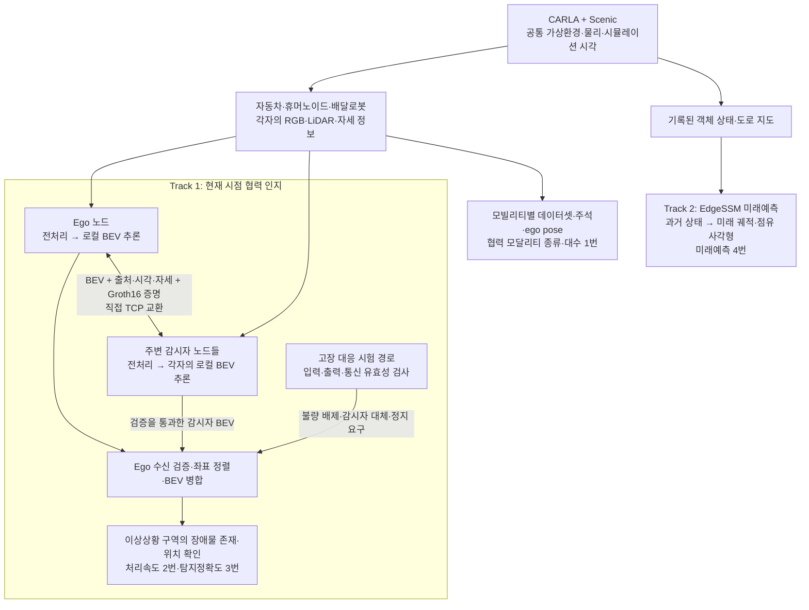

# 2026년 수행내용

**1단계 2차년도: 협력 인지·ZKP 공유 통합, HW·SW 고장 15종, 미래 BEV 연구, CARLA 통합 검증.**

- 이상상황 S1~S9 9종은 [2025년 완료 성과](2025.md#서브시스템2). 올해는 이를 활용한 배치·연결·통합·평가에 집중.
- 기준일: 2026-10-31. 구현·연구 결과와 공식 성적서 발급·보고서 작성 완료를 구분.
- [2025년 수행내용](2025.md) · [성능지표](metrics.md) · [사용법](usage.md) · [준비 현황](status.md).

| 구분 | 수행내용 |
|---|---|
| [서브시스템1](#서브시스템1) | Groth16 기반 직접 공유·수신 검증·메시지 규격 |
| [서브시스템2](#서브시스템2) | 고장 15종·불량 배제·감시자 대체·정지 요구·서비스 복귀 |
| [서브시스템3-1](#서브시스템3-1) | 카메라 기반 미래 BEV 예측·적응적 정제 |
| [서브시스템3-2](#서브시스템3-2) | CARLA·Scenic·모빌리티·센서·인지·공유 연결, 실패 개선 검증 |

## 통합 구성



**실행 구성:**

- 메인 시스템: 가상 세계·공통 시각·실행 순서·노드 등록 관리.
- 인지 데이터: 별도 중앙 인지 서버를 거치지 않는 노드 간 직접 통신.
- 현재 검증 배치: **한 호스트의 독립 프로세스·공유 GPU·TCP loopback**.
- 실제 다중 PC·무선망 배치와 구분.

## 서브시스템1

**탈중앙형 협력 인지 시스템**

### BEV 공유·인증

- 각 노드가 로컬 BEV를 생성하고 기본 반경 60m 이내 Ego·감시자 사이에서 직접 교환.
- 제공 DAMOS_zkp 회로·키·WASM으로 실제 Groth16 증명 생성·검증.
- 공유 내용: 클래스 확률·관측 마스크·자세·프레임·시각·모델 식별정보.
- 등록 송신자·본문 SHA-256·회차·시각·모델·증명을 검사한 후 유효한 BEV만 병합.
- 감시자끼리 교환은 제외. 현재 시험 배치는 단일 호스트의 독립 프로세스·공유 GPU·TCP loopback.
- 수신 이후의 좌표 정렬·병합은 [서브시스템3-2](#서브시스템3-2), 전체 처리속도는 [성능지표 2번](metrics.md#2번-18초-처리시간)에서 정리.

### 초기 이미지 전송 PoC

- CARLA 0.9.15에서 차량 A·B·C가 30m 이내 접근하면 nuScenes 6방향 이미지 번들 345,666B 교환.
- 동일 메시지 구조에서 Schnorr 서명과 Groth16 증명 비교. Schnorr 서명을 영지식 증명으로 취급하지 않음.
- 이미지별 SHA-256 머클 루트·세션·송수신자·시각·챌린지·차량 상태를 메시지에 결합.
- 이미지 변조·다른 차량 이미지 교체·신원 위조·재전송의 공격 4종에 대한 거부 동작 확인.

| 단계 | Schnorr | Groth16 |
|---|---:|---:|
| 서명·증명 생성 | 32.54ms | 393.79ms |
| 검증 | 67.23ms | 301.53ms |
| 직렬화·기타 검사 | 3.19ms | 7.28ms |
| 총 통신 비용 | 102.96ms | 702.60ms |
| 패킷 크기 | 463,994B | 1,170,101B |

- 별도 프로파일링의 Groth16 전체 시간은 787.1ms. 다른 측정 조건의 수치를 합산하지 않음.
- 초기 이미지 번들 PoC와 현재 CARLA 0.9.16·60m BEV 통합은 서로 다른 입력·통신 조건.
- 현재 BEV 통합에는 초기 PoC의 회로·키·WASM을 적용. 이미지 PoC의 인증 비용을 전체 인지 처리시간으로 사용하지 않음.

### 메시지 규격

| 구성 | 현재 BEV 시험 메시지 |
|---|---|
| 길이정보 | 헤더·본문 길이 각 4B, 빅엔디언 |
| 인증 헤더 | manifest·proof·public_inputs, JSON 1,783B |
| BEV 본문 | float16 확률 지도·uint8 관측 마스크, 1,400,000B |
| 합계 | 1,401,791B. TCP/IP 부가량 제외 |

- JSON은 키 정렬·구분 공백 생략·비ASCII 이스케이프 후 UTF-8 인코딩.
- 본문은 Base64 없이 원시 바이트로 연결. 확률은 리틀엔디언 float16.
- 공개 입력은 등록 커밋먼트·문맥 해시·manifest 해시. 비공개 Witness·증명 및 검증 키는 전송하지 않음.
- 단방향 BEV 인증은 메시지 1회 전송·수신 검증. 초기 이미지 PoC와 달리 별도 Challenge·Response 교환 없음.
- 시험 메시지의 증명 724B·공개 입력 238B·JSON 필드명 및 구분 기호 26B를 합한 증명 관련 이론적 증가분 988B. 인증 미적용 시스템의 실측값은 아님.
- 활성 노드 수 N에서 정상 회차당 송신 2(N-1)회, BEV 본문 총량 2(N-1)×1,400,000B.
- 송신자별 수신자 집합에 대한 증명은 한 번 생성하여 재사용. 수신자별 복제 전송과 구분.

**ZKP·M2X 공유:**

- 문제: 발신자 확인, 본문 변조·과거 패킷·잘못된 증명 배제.
- 제공 DAMOS_zkp 회로·키·WASM으로 실제 Groth16 사용.
- BEV 패킷 adapter로 현재 메시지 연결.
- 본문 해시·수신자·세션·회차·시각·모델을 결합·검증.
- 코드: `m2x/security.py`, `bev_protocol.py`, `bev_mesh.py`.

**ZKP 검증 범위:**

- 등록 송신자와 전달 메시지의 결합·무결성 확인.
- 모델 실행·인지 정확도·센서 내용의 현실적 진실성·암호화는 증명하지 않음.
- 현재 신뢰된 로컬 등록·직접 TCP prototype.
- 외부망용 보안 배포와 구분.

## 서브시스템2

**자가 기능 복원·대응 시스템**

- 올해 중심 성과: HW·SW 결함 발생 가능 시나리오 F01~F15 개발.
- 추가 구현: 규칙 기반 유효성 검사·협력 정보 대체·정지 요구·서비스 복귀.
- 전용 `run_carla_resilience.py` 시험 경로에서 검증. 일반 live BEV 실행에 안전제어가 항상 연결된다는 의미는 아님.
- 아래 60조건은 고장 대응 동작 시험이며 [성능지표 3번](metrics.md#3번-이상상황-탐지정확도)의 탐지정확도 시험과 별개.

### 고장을 판단하는 방법

특별한 고장 진단 AI가 아니라 입력·수신 데이터의 사용 가능성을 확인하는 규칙 기반 검사. 고장 주입 코드가 데이터를 바꾸는 부분과, 수신부가 실제 데이터를 검사하는 부분을 구분.

**정상 참조 비교:**

- 동일 장면·날씨에서 고장 주입 전 취득한 정상 영상·LiDAR를 비교 기준으로 보존.
- 정상 대비 영상 선명도 10% 미만·LiDAR 점 수 25% 미만이면 불량 판정.
- 불량 데이터는 정상 참조 갱신에서 제외.
- 참조 비교 외에도 형식·장착값·스캔 범위·현재 프레임·시각·본문 해시·증명을 검사.
- 현재 검증은 정지 장면·통제된 고장 조건 기준. 자연 주행의 장면·날씨 변화에 대한 오탐률은 별도 검증 대상.

| 대상 | 검사 근거 | 판단의 한계 |
|---|---|---|
| RGB 소실 | raw 크기, 현재 프레임·동기 시각, 정확히 검정인 픽셀 비율 99.99% 이상 | 물리 카메라 고장 원인을 확정하는 진단은 아님 |
| 강한 흐림 | 직전 정상 참조 대비 Laplacian 선명도 비율 0.10 미만 | 정지 배경의 참조 사용. 모든 악천후·가림 감지기는 아님 |
| 카메라 장착 | CARLA 실측 transform과 선언 보정값의 차이: 회전 3도 또는 위치 0.05m 초과 | 실차 자세 추정·자동 보정 아님 |
| LiDAR | 빈/비정상 수치, 과거 프레임, 정상 참조 대비 점 수 25% 미만, 스캔 범위 위반 점 5% 초과 | 일반 노이즈·정상 범위 안 거짓 점의 전부를 검출하지 못함 |
| 감시자 미수신 | 처리 회차 시작 기준 8초 마감까지 사용할 정보가 도착했는지 확인 | 통신선 단절·상대 정지·과도한 지연의 원인을 구분하지 못함 |
| BEV 본문 변경 | 받은 바이트의 SHA-256 재계산·길이 확인, 송신 기록과 비교 | 불일치는 무결성 실패이며 공격자나 원인 확정은 아님 |
| 발신/메타데이터·증명 | 등록 송신자·actor·수신자·메시지 결합·실제 Groth16 증명 검증 | 정상 등록 송신자가 의미적으로 거짓인 BEV를 보내는 경우는 방어 범위 밖 |
| 과거 패킷 | session·round·frame·시각·캡처 시점·모델 일치 확인 | 현재 동기화된 CARLA 환경의 검사 |
| 과거 모델 출력 | 출력의 round·frame·수집시각과 현재 요청 대조, 실제 추론 시작/완료 기록·회차 마감 검사 | 결과 미반환·OS 멈춤·새 메타데이터로 위장한 거짓 출력은 별도 범위 |

통신 단절 시험은 감시자→Ego 전송을 실제 생략, 변조 시험은 증명 생성 후 본문 변경. Ego 수신부는 고장 주입 이름이 아니라 미수신·검증 실패 결과를 사용. 불량 패킷을 배제한 뒤에도 원래 마감까지만 정상 패킷 대기.

**F09 보완:** 실제 추론 완료 때 BEV와 원래 회차·프레임·수집시각·추론 시작/완료시각을 함께 보존. 고장 주입부는 이 과거 결과 묶음만 반환하며 사용 불가 표시를 직접 설정하지 않음. 공통 `inspect_model_output`은 주입 이름을 받지 않고 현재 요청과 대조해 `STALE_MODEL_OUTPUT` 판정. 거부한 실제 BEV는 별도 보존하고 송신·병합에서 배제, 현재 좌표의 미관측 BEV만 송신. Ego는 검증된 감시자 BEV로 대체 후 새 출력 3회 연속 확인으로 복귀.

정지 장면에서 BEV 내용이 같다는 이유만으로 고장 판정하지 않음. 주입 표시 없는 과거 결과 배제·같은 내용의 새 결과 허용을 단위시험으로 검증. 추론 완료 기록은 신뢰된 로컬 실행 경계의 기록이지 모델 실행에 대한 암호학적 증명이나 실제 OS 프로세스 정지 시험은 아님.

구현 근거: [raw·수신·F09 처리](../Carla-0.9.16-source/_DAMOS/scripts/bev_resilience.py), [패킷 검증](../Carla-0.9.16-source/_DAMOS/scripts/bev_protocol.py), [품질 검사](../Carla-0.9.16-source/_DAMOS/scripts/bev_fault_quality.py).

### 서비스 상태와 통과 기준

| 상태 | 조건·동작 |
|---|---|
| `NORMAL` | 정상 로컬 입력과 검증된 감시자 정보로 병합, 복귀 연속 조건 충족 |
| `DEGRADED_COOPERATIVE` | 로컬 입력/출력 사용 불가, 정상 감시자 BEV로 대체 |
| `SAFE_STOP` | 사용 가능한 감시자 정보 부재·관측 셀 부족·결과 노후화 시 정지 요구 |
| `RECOVERING` | 정상 데이터 복귀 확인 중. 3회 연속 충족 전 정지 요구 유지 |

각 고장 조건은 **정상 3회 → 고장 주입 1회 → 주입 해제·복귀 3회**. 아래 항목을 모두 확인하면 해당 조건 통과:

1. 고장 전 정상 상태, 주입 중 정해진 대체/정지 요구 상태로 전환.
2. 불량 로컬 데이터·검증 실패 패킷을 병합에서 제외. F02~F06은 실제 손상 입력의 모델 후보도 생성·보존 후 배제.
3. 고장 해제 후 정상 데이터 3회 연속 확인으로 서비스 `NORMAL` 복귀.
4. 판정 중 Ego 차도 위치·무접촉, 정지 요구 조건의 별도 저속 제동 확인.
5. 실제 날씨·서버 Epic 품질·사전 계획 일치, 실행 누락·오류 없음.

비교 중 Ego는 정지 유지. 별도 제동은 초기 약 2m/s를 실제 tick 이후 확인하고, brake=1 적용 후 5 시뮬레이션 초 이내 0.2m/s 이하 정지 확인. 자연 주행 중 장애 발견부터 정지까지의 안전 거리·전체 지연이나 운행 자동 재개 시험은 아님.

**감시자 BEV가 장애물을 놓쳐도 위 동작이 정상이면 이 시험은 통과 가능.** 출력의 유효 관측 3셀은 가용성 확인이며, 정답 장애물과의 위치 일치·연속 탐지 판정과는 다름. 수신 회차 마감 8초·시험용 결과 노후화 상한 20초는 성능지표 2번의 18초 계측과 별개.

### 고장 15종

통합 목록의 단일 13종·복합 2종. 실제 CARLA raw 입력·모델·통신 경로의 소프트웨어 결함 주입이며 물리 센서 파손 시험은 아님. 표의 모든 종류가 자동 원인 진단을 구현했다는 뜻은 아님.

| ID | 주입 내용 | 검사·검증 수준 | 기대 대응 |
|---|---|---|---|
| F01 | Ego 정면 RGB를 검정으로 대체 | raw 검정 비율·형식 검사 | 감시자 대체 |
| F02 | 정면 raw에 101×101, sigma=25 흐림 | 정상 참조 대비 선명도 검사. 가림·색 이상·흔들림 실처리 검증과 구분 | 감시자 대체 |
| F03 | 실제 정면 센서를 yaw +25도로 재부착, 원 보정값 유지 | 실측/선언 장착 오차 검사, 복귀 때 실제 재부착 | 감시자 대체 |
| F04 | LiDAR XYZ에 표준편차 4m 노이즈 | 알려진 스캔 각도·거리 범위 검사 | 감시자 대체 |
| F05 | 실제 LiDAR 점의 10%만 유지 | 정상 참조 대비 점 수 검사 | 감시자 대체 |
| F06 | BEV 안·수직 스캔 범위 밖 가짜 점 50% 추가 | 스캔 범위 위반 비율 검사 | 감시자 대체 |
| F07 | LiDAR raw 비움 | 입력 유무·수치 검사 | 감시자 대체 |
| F08 | 과거 실제 센서 입력 유지 | 현재 프레임·동기 시각 검사 | 감시자 대체 |
| F09 | 과거 실제 모델 출력·추론 완료 기록 유지 | 주입 이름 없이 출력 프레임·시각·회차·완료 기록 검사. 기본 네 날씨 재검증 | 감시자 대체 |
| F10 | 감시자의 패킷 송신 생략 | 마감까지 유효 데이터 미수신 | 정지 요구 |
| F11 | 증명 생성 후 BEV 본문 변경 | 본문 해시 불일치·미병합 확인 | 정지 요구 |
| F12 | 이전 실제 본문·증명 재전송 | session/round/frame·시각 검사 | 정지 요구 |
| F13 | 실제 Groth16 증명 일부 변경 | 실제 증명 검증 실패 확인 | 정지 요구 |
| F14 | Ego 6방향 RGB·LiDAR 동시 소실 | 각 입력의 소실 검사, 복합 조건 | 감시자 대체 |
| F15 | Ego RGB·LiDAR 소실+감시자 송신 생략 | 입력 소실+유효 감시자 부재, 복합 조건 | 정지 요구 |

F09의 이전 `module_stop`·`stale_perception_output` 이름은 같은 출력 고정 항목의 별칭. F05 부분 누락과 F07 전체 소실은 서로 다른 조건. 간편 이미지 보고서 8종은 위 목록의 일부이며 추가 합산하지 않음.

### 최신 60조건 결과

S5는 고장 시험의 배경인 인도 불법 주차 차량 6대·앵커 1곳. 날씨별 새 서버/장면 1개에서 15종 고장을 순서대로 적용한 **4개 장면·60조건**이며, 무작위 독립 장면 60개가 아님.

| 기본 날씨 | 실행 이름 | 대응 통과 |
|---|---|---:|
| 저각 햇빛 | `low_sun` | 15/15 |
| 폭우 | `heavy_rain` | 15/15 |
| 짙은 안개 | `dense_fog` | 15/15 |
| 젖은 야간 | `wet_night` | 15/15 |
| 합계 | S5 × 날씨 4 × 고장 15 | 60/60 |

| 확인 항목 | 결과 |
|---|---|
| 실행·상태 | 420라운드: 정상 180·고장 60·복귀 180, 종료 코드 모두 0 |
| 실제 서비스 CUDA 추론 | 816회. 새 추론 없는 24개 슬롯·워밍업 별도 |
| 고장 중 동작 | 감시자 대체 40조건·정지 요구 20조건 |
| 별도 저속 제동 | 20/20 통과 |
| 실제 Groth16 증명 | 첫 감사에서 840/840개 재검증 |
| 병합·상태·손상 입력 | 420회 병합/상태 일치, 손상 raw/전처리 20개 재현 |
| 모델 수치 재현 | 손상 입력 20개 × 프로세스 2개 × 각 3회, 120/120회 비트 단위 일치·차이 0 |
| 날씨·품질 | 초기 날씨 4회·라운드 날씨 420회·실제 Epic 서버 인자 4회 일치 |
| 코드 검증 | 소스/설정 23개 보존. 회귀 270개 중 266개 통과·선택 4개 제외·실패 0 |

독립 감사 두 프로세스 모두 종료 코드 0. 두 번째 감사는 모델·자료 재현 반복이며 증명 수에 중복 합산하지 않음. 모델 재현 기준은 최대 확률 오차 0.01·평균 0.0001 이하, 관측 마스크·pose 정확 일치. 120회 재추론은 새 CARLA 조건 120개가 아님.

환경: vvu, Ubuntu 22.04 계열, Ryzen 5 9600X, RTX 5060 Ti 16GB, Python 3.10.18, torch 2.7.0+cu128. Town10HD_Opt, Ego 1대+60m 이내 배달로봇 감시자 1대, 단일 호스트·독립 프로세스·TCP loopback. 날씨는 RGB 효과이며 일반 LiDAR의 강우/안개 물리적 감쇠·젖은 노면 마찰은 미포함.

과거 30·45조건, Low 60조건, 예비시험·최초 실패 기록은 원본 보존하며 최신 60조건에 합산하지 않음. 실행환경·고장 대응의 상세 개발 이력은 [정리 전 기술문서](https://github.com/7107190/STL_DAMOS/blob/e018060cf17b0d2991ee3a703cfbe4f1b5723d26/docs/consulting_response.md)와 원 시험 폴더 참조. 실제 인지 실패의 원인·개선 검증은 [5번 대응](#5-실패-분석과-변경재검증) 참조.

#### F09 독립 감지 재검증

S5·Epic·`low_sun`/`heavy_rain`/`dense_fog`/`wet_night` 각각 정상 3회 → 출력 고정 1회 → 복귀 3회 실행, **4/4조건 통과**. 현재 센서 입력은 정상인데 모델 출력의 회차·프레임·수집시각·추론 시작 기록이 과거인 것을 공통 검사로 배제. 미관측 로컬 BEV·감시자 대체·3회 복귀 확인. 기존 60조건을 수정하거나 64개 독립 시나리오로 합산하지 않음.

28라운드·실제 서비스 추론 52회. 독립 감사 두 프로세스에서 출력 최신성 56건·병합/상태 28건 일치, 첫 감사의 실제 Groth16 증명 56/56 재검증. 추가 `low_sun` 회귀는 F09·센서 지연·강한 흐림·통신 단절 4/4, 손상 입력 재추론 3/3 비트 단위 일치. 단위 회귀 279개 중 275개 통과·선택 4개 제외. 수정 후 전체 60조건 재실행은 아님.

**고장 대응:**

- 문제: 불량 입력·묵은 출력·수신 실패 정보의 병합 방지.
- 데이터 기반 유효성 검사.
- 감시자 대체 또는 정지 요구.
- 정상 3회 연속 확인 후 서비스 복귀.
- 코드: `bev_fault_quality.py`, `bev_resilience.py`.

### 고장 대응 증빙

최신 고장 시험 원본:

```text
/home/vvu/vv/_Data/Carla/Columbus/DAMOS_results/resilience_base_weather_20261024_all60_v2/
```

| 파일·폴더 | 용도 |
|---|---|
| `summary.json` | 60조건·회차별 실제 판정·상태 |
| `protocol.json`, `frozen_source/`, `environment.json` | 사전 기준·날씨·품질·소스 해시·모델·환경 |
| `audit_replay_process1.json`, `audit_replay_process2.json` | 증명·배열/상태·실제 모델 재추론 결과 |
| `validation_summary.json` | 실행·두 감사·사전 확인·해시 통합 |
| `figures_v1/service_response_matrix.png` | 60조건 대응표 |
| `weather_views_v1/weather_baselines.png` | 날씨별 같은 라운드 Ego/감시자 전방 RGB |
| 날씨별 `resilience/` | raw·예측·본문·증명·등록·상태·제동·로그 원본 |

시험 당시 공유 요약 경로는 `/Volumes/STL/과제/2025.04 콜럼버스 - DAMOS/1단계-2차년도[2026]/2차년도 연차보고서/컨설팅보완대응_2_4_5/20261024_기본날씨60조건_Epic/`. 이 날짜의 문서·manifest는 시험 당시 사본으로 보존하며, 최신 해석은 이 문서 기준.

F09 새 원본: `DAMOS_results/resilience_f09_guard_20261026_v1/`. `protocol.json`의 `model_output_guard`, `audit_process*.json`, 출력 메타데이터·거부한 실제 예측·현재 송신 본문 보존. 추가 경로 회귀는 `DAMOS_results/resilience_f09_regression_20261026_v1/`에 별도 저장.

### 미검증 범위와 후속 작업

- 출력 미반환·OS 프로세스 멈춤 시 외부 watchdog·재시작·제한시간 내 대체. 현재 F09는 과거 결과 반환이며 프로세스를 강제로 멈춘 시험은 아님.
- 고장 상태 탐지정확도: 60조건별 정답 장애물과 병합 BEV의 존재·위치·연속 탐지 대조 필요. 현재 60/60 대응 결과와 별개.
- 자연 주행 중 회피·안전정지 전체·운행 자동 재개, 장시간 운행·다수 감시자·다중 PC·실제 무선망·물리 센서·실도로는 별도 검증.
- Groth16은 등록 송신자·메시지 결합의 검증. 센서의 현실적 진실성·모델 실행·인지 정확도·암호화를 보장하지 않음.
- 신뢰된 로컬 등록·직접 TCP prototype이며 TLS·실제 무선 discovery는 미구현. 외부 네트워크에 그대로 노출하지 않음.

### 피드백 2·4 대응

- ✅ 서브시스템2 마지막 `다. 고장 대응 검증 및 보완의견 반영`에 반영 완료.
- 강건 서비스: 로컬 불량 시 검증된 감시자 관측으로 서비스 유지, 정보 부재 시 정지 요구, 정상 3회 확인 후 복귀.
- 같은 장면·날씨의 정상 참조 비교와 실제 입력·출력·패킷 검사를 함께 사용.
- 악천후·통신 단절·악성 정보·복합 고장에 대한 배제·대체·정지·복귀 기준 제시.
- S5 60조건·별도 저속 제동 20/20으로 지정 조건의 대응 확인.
- 실모빌리티·실도로·실제 무선망·자연 주행 안전전환·장시간 서비스 검증은 후속 범위.

## 서브시스템3-1

**카메라 기반 미래 BEV 예측**

### 연구 구성

- 카메라 입력만으로 미래의 2D 고밀도 BEV semantic map을 생성하는 coarse-to-fine 구조.
- Cam-to-BEV encoder: 영상 backbone·depth-aware lift·Z축 압축·ego-motion 정렬.
- SpatialMamba·Temporal Mamba로 초기 미래 특징·logit 생성.
- Selective Refiner: error score와 Conformal Risk Control(CRC) 임계값으로 정제 패치·개수 선택.
- Fine temporal refiner: 선택 패치의 잔차 보정으로 17종 클래스 BEV 출력.
- 비교 기준은 UGAFR 기반 고정 K=256 패치 선택 정책.

| 항목 | 설정 |
|---|---|
| 데이터 | nuScenes 6방향 카메라, 2Hz |
| 정답 | Occ3D-nuScenes의 2D BEV |
| 입력 | 과거·현재 6프레임, T-5~T |
| 출력 | 미래 10프레임, T+1~T+10 |
| 격자 | 200×200, 셀 크기 0.4m |
| 정제 패치 | 4×4셀, 총 2,500개 패치 |
| 학습 GPU | RTX 5090 × 4, GPU당 32GB |

### 확인 결과·보고서 상태

- 주거지 도로·우천 교차로·공사 구간·교차로 진입 4개 nuScenes 장면의 입력·정답·coarse·refined 비교.
- 객체 주변과 교차로·연석 경계에 정제 패치를 배정하고, 정제 후 객체 형상·경계의 정성적 개선 확인.
- 논문 제목: “Where and How Much to Refine: Calibrated Adaptive Refinement for BEV Semantic Forecasting”.
- 통합 보고서의 논문 상태는 Results in Engineering, 2026, Under Review. 최종 게재 완료로 표기하지 않음.
- ✅ 이예린 원고를 2차년도 수행내용 통합본에 반영.
- 현재 RGB·LiDAR 로컬 BEV 공유 경로 및 상태·지도 기반 EdgeSSM 평가와 구분.
- [성능지표 4번](metrics.md#4번-미래예측-지평과-유효-생성)의 달성 결과 본문 추가는 박준범 작성 대기. 해당 결과를 이 모델의 평가로 대체하지 않음.

## 서브시스템3-2

**복합 모빌리티 혼재 환경 통합 시뮬레이션**

### 환경·감시자·센서 입력

- 2025년 개발한 [이상상황 S1~S9](2025.md#scenic-이상상황-9종)를 활용.
- 기존 시나리오 개발 성과를 올해 신규 개발로 중복 계상하지 않음.

**환경 생성:**

- CARLA Town10HD_Opt에서 Scenic이 Ego와 이상상황 객체 생성.
- 일반 주행 Ego는 빨간 `vehicle.ford.mustang` 1대.
- 일반 주행에서는 autopilot 사용.

**감시자 배치:**

- 이상상황의 개별 객체 또는 군집을 앵커로 정의.
- 앵커마다 감시자 1대를 인도에 배치, 해당 상황 방향으로 고정.
- 휴머노이드·배달로봇 중 랜덤 선택.

**동기 입력 구성:**

- 각 노드의 RGB 6방향 × 과거 4프레임 취득.
- 현재 일반 LiDAR 1프레임 취득.
- 센서 간·노드 간 공통 프레임 사용.
- 장착 위치, 카메라 내·외부 파라미터, 자세를 함께 구성.

**개별 BEV 추론:**

- 각 노드가 자신의 입력으로 추론 수행.
- 출력: 17종 클래스 확률과 관측 마스크.
- 범위: 노드 중심 80m × 80m.
- 격자: 200 × 200셀, 셀 크기 0.4m.

**존재·위치 확인:**

- 병합 결과를 장애물·지면·미관측으로 해석.
- Scenic 이상상황 구역의 장애물 존재·위치 평가.
- 세부 객체 종류·행동 분류와 구분.

**LiDAR 역할:**

- 단순 표시용이 아닌 모델의 공간·높이·관측 범위 입력.
- RGB와 함께 인지에 사용.
- 일반 LiDAR의 지면 형상은 도로 오탐 보정에도 사용.
- **미관측 셀은 빈 공간으로 간주하지 않음.**

**실시간 처리 방식:**

- Scenic이 진행되는 동안 모델 처리 수행.
- 처리 완료 후 최신 공통 입력으로 다음 회차 시작.
- 모든 시뮬레이션 tick의 추론을 보장하는 방식은 아님.
- 영상 FPS와 모델 처리 횟수는 별개.

### 인지·공유·병합 연결

**검증·병합:**

- 등록 송신자·본문 해시·증명 검사.
- 회차·시각·모델 일치 여부 검사.
- 통과한 BEV만 자세 변환으로 Ego 좌표계에 정렬.
- 관측·신뢰도 기준으로 병합.
- 선택 기능 `relative-v3`: Ego의 불확실한 지면 판정을 더 강한 감시자 관측으로 보완.
- 희소 LiDAR 구조 복원과 고신뢰 감시자 반영 유지. 추가 관측은 Ego 지면 점수와 비교해 수용.
- 기본값 `off`. 활성화·검증 범위는 [사용법](usage.md#상대-신뢰도-병합-옵션) 참조.

**시뮬레이션 통합:**

- 문제: CARLA·Scenic·후속 노드의 실행 순서와 시계 충돌.
- 서버 준비 → Scenic Ego/객체 생성 완료 확인 → 감시자·센서 부착.
- Scenic 외부에서 임의 tick 진행 금지.
- 코드: `run_scenic_custom_walkers_town10hd.sh`, `scenic_custom_walker_injector.py`.

**이상상황·앵커:**

- 문제: 객체 수와 감시 지점 혼동, 잘못된 객체 재선택.
- S1~S4는 개별 객체 단위.
- S5~S9는 의미 있는 구역·군집 단위.
- 원래 Scenic actor ID와 구성 객체 유지.
- 코드: `scenic_custom_walker_injector.py`.

**커스텀 모빌리티:**

- 문제: 로봇 외형·보행자 기반 동작·카메라 가시성 연결.
- CARLA Unreal 소스에 custom walker factory·pose·visibility 컴포넌트 추가.
- 센서 영상까지 정지하던 가시성 전파 수정·모듈 재빌드.
- 코드: `custom_walker_runtime.py`, [Unreal overlay](../Carla-0.9.16-source/Unreal/CarlaUE4/Plugins/Carla/Source/Carla/Damos/).

**센서·동기화:**

- 문제: 모빌리티별 장착 차이, 다른 프레임·보정값 혼합.
- RGB 6개+일반 LiDAR 1개, 공통 4프레임 버퍼 사용.
- CARLA 좌표계 변환·카메라 보정·전처리 적용.
- 코드: `bev_sensor_rig.py`.
- 장착 기준: [sensor_config.txt](../sensor_config.txt).

**개별 인지:**

- 문제: 전달 모델을 실제 센서 입력에 연결.
- 입력 shape·taxonomy·가중치 strict load·학습 step 유지.
- 실제 CUDA 추론 후 확률·관측 마스크·자세 반환.
- 코드: `bev_model_runtime.py`.

**도로 오탐 보정:**

- 문제: 도로가 장애물로 보이며 대상 구역 확인 방해.
- 일반 LiDAR 지면 평면·높이·구조 주변 보존을 이용한 보정.
- 고정 체크포인트로 관리.
- 평가 정답을 실행 입력으로 사용하지 않음.
- 코드: `bev_lidar_calibration.py`, `bev_ground_guard.py`.

**Ego 기준 병합:**

- 문제: 서로 다른 위치·방향의 BEV를 같은 지도에서 해석.
- 자세 기반 inverse warp 적용.
- 유효 관측과 신뢰도로 병합.
- 감시자로 추가된 관측 셀·기여 출처 보존.
- 선택적 보완: 높은 위치의 단일 LiDAR 반환을 인접 구조와 함께 확인해 복원.
- 점수 0.50 이상 0.60 미만 감시자 관측은 Ego가 관측한 지면 점수보다 높은 경우에만 추가 반영.
- 검증을 통과한 관측과 보행자·자전거 출력, 주변 장애물 근거 사용. 기존 장애물 탐지 유지.
- 코드: `bev_fusion.py`, `bev_evidence_correction.py`, `bev_relative_fusion.py`, `bev_occupancy.py`.

**평가·증빙:**

- 문제: 생성 객체·예측·캡처 불일치, 재현 불가능한 수치.
- 동일 actor·프레임·시각의 정답 대조.
- 코드/입력 해시·실제 증명·병합·상태 사후 감사.
- 코드: `bev_anchor_evaluation.py`, `audit_carla_resilience.py`.

**시각화:**

- 문제: 서로 다른 시점 영상, LiDAR 간격과 예측의 혼동.
- 같은 프레임의 Ego/감시자/병합 BEV와 RGB를 2×3으로 구성.
- 화면용 보간·GT 윤곽·EGO 표식은 공유·평가 입력에서 제외.
- 코드: `bev_passby_video.py`, `bev_video_render.py`.

### 관련 성능지표

- [1번](metrics.md#1번-모빌리티-종류대수와-데이터셋): 모빌리티 종류·대수·독립 데이터셋. 최종 집계 미확정.
- [2번](metrics.md#2번-18초-처리시간): Ego 기준 전처리부터 추론·공유·병합·장애물 존재 판정까지의 처리속도.
- [3번](metrics.md#3번-이상상황-탐지정확도): 신규 앵커 100건의 장애물 존재·위치 연속 탐지.
- [4번](metrics.md#4번-미래예측-지평과-유효-생성): 별도 EdgeSSM 입력·추론·평가 경로. 현재 병합 BEV의 미래예측 기능과 구분.
- 숫자·판정 기준·제출 ZIP은 성능지표 문서에서 관리. 공인 성적서 발급 상태는 [준비 현황](status.md) 참조.

### 5. 실패 분석과 변경·재검증

**분석 대상:**

- 원 제출 평가의 실패 3건과 후속 어린이 보행자 시험의 미달 사례.
- 입력·증명·통신은 정상이지만 장애물 셀의 연결이 끊겨 연속 탐지 0.5초 기준에 미달한 상황.
- CUDA·렌더링·카메라 갱신 오류와 구분한 알고리즘 실패 분석.

| 실패 사례 | 원인·관측 | 적용한 보완 | 동일 저장 자료의 최종 비교 |
|---|---|---|---|
| `M3-075-S3` | 작은 보행자의 관측 영역 일부 미탐지, 연결 장애물 3셀 확보 불안정 | 일반 LiDAR의 높이·수직 구조·인접 장애물 근거 보강 | 원본 0.4초 → 최종 1.0초 |
| `M3-082-S1` | 작은 보행자의 희소 관측 일부를 지면으로 판정 | 관측 격자의 구조 기반 복원, 기존 장애물 유지 | 원본 0.4초 → 최종 1.0초 |
| `M3-084-S3` | 야간의 작은 보행자 영역이 점유 보정 과정에서 감소 | 높이·구조·모델 근거를 함께 사용한 복원 | 원본 0.4초 → 최종 1.2초 |
| 추가 `FIX31-S1-low_sun` | Ego 지면 오분류, 감시자 보행자 점수 약 0.502가 고정 0.60 문턱에서 배제 | 점수 0.50~0.60 관측을 Ego 지면 점수와 비교해 조건부 수용 | 원본 0.2초·이전 보완 0.4초 → 최종 0.6초 |

**최종 구현:**

- 높은 위치의 단일 LiDAR 반환은 인접한 수직 구조와 장애물 근거를 확인하여 복원.
- 고신뢰 감시자 관측 반영 유지. 추가로 0.50 이상 0.60 미만 관측은 Ego의 유효한 지면 점수보다 높은 경우만 반영.
- 보행자·자전거 출력, 감시자 유효 영역·주변 장애물 관측 확인. 기존 장애물 탐지 보존.
- 실제 Groth16 검증 뒤 Ego 병합에 적용. GT·평가 마스크·actor ID는 예측 입력에 미사용.
- 일반 BEV 공유의 선택 기능 `relative-v3`, 기본값 `off`. 전용 고장 대응 서비스 경로는 변경하지 않음.
- 코드: [구조 복원](../Carla-0.9.16-source/_DAMOS/scripts/bev_evidence_correction.py), [상대 신뢰도](../Carla-0.9.16-source/_DAMOS/scripts/bev_relative_fusion.py), [실행 연결](../Carla-0.9.16-source/_DAMOS/scripts/bev_mesh.py).

**전체 개발 자료 재검사:**

- 저장 122건·1,279샘플. 원본 115건, 이전 보완 121건, 상대 신뢰도 포함 최종 122건 기준 충족.
- 구성: 원 제출 100건·추가 생성 16건·어린이 집중 4건·이전 후보 확인 2건. 아래 새 시드 4건과 구분.
- 기존 성공 손실 없음. 알려진 자료를 활용한 개발 검증이며 원 제출 100건의 성적으로 대체하지 않음.
- 지면 오탐 보조 비율: 이전 보완 3.8047% → 최종 3.8085%. 일괄 0.50 수용은 3.8128%.
- 해당 비율은 시맨틱 LiDAR 지면 반환 셀 중 장애물 겹침을 제외한 진단. 전 영역 정밀 오탐률과 구분.

**새 시드의 실제 모델·Groth16·병합 검증:**

| 조건 | 원본 최장 연속 탐지 | 보완 후 최장 연속 탐지 | 판정 |
|---|---:|---:|---|
| S1·저각 햇빛 | 0.6초 | 0.6초 | 충족 |
| S1·짙은 안개 | 0.2초 | 1.4초 | 충족 |
| S3·폭우 | 0.8초 | 0.8초 | 충족 |
| S3·젖은 야간 | 0.0초 | 0.8초 | 충족 |

- 시드 2026103151~2026103154 사전 고정. 어린이 `.0010`, `.0012`, `.0009` 모델 사용.
- 각 6초·5Hz·30샘플 취득 후 실제 처리. 4/4건 기준 충족, 원본 병합은 같은 입력에서 2/4건.
- 새 4건은 전체 보완 경로의 검증. 상대 신뢰도 추가만의 정확도 향상으로 해석하지 않음.
- Ego+감시자 1대 조건. 저장된 120개 BEV와 독립 재계산 결과 일치.
- 추가 보정 포함 Ego 최대 1.520368336초, 보정 최대 49.686615ms. 120샘플 모두 18초 이내.
- 기본 네 날씨의 지정 4조건이며 S1~S9·모든 고장과의 교차 검증은 아님.

**보고서 반영·확인 범위:**

- 서브시스템2 마지막 `다. 고장 대응 검증 및 보완의견 반영`에 강건 서비스의 정의·검증·협력 대응의 의의 통합.
- 서브시스템3-2 `마. ZKP 기반 정보 공유·Ego BEV 병합 구현`에 상세 알고리즘, 마지막 `사. 탐지정확도 검증 및 보완의견 반영`에 실패 분석·표 13·14·재검증·우수성·후속 계획 통합.
- 별도 아·자 항목과 반복 요약표 15 삭제. 대응 문구는 두 시스템의 마지막 항목에 배치, 내부 관리 번호는 보고서에서 미사용.
- 기존 성능지표 2번의 135회·최대 1.911553289초와 3번의 97/100·97% 유지.
- 서브시스템2의 15종·60조건 고장 대응 결과 및 서브시스템1·3-1의 담당 내용은 유지.
- 한글 원본 반영·본문/표/그림/수치·문서 구조 대조 완료. 최신 수정본의 화면 배치는 한글 자동화 도구 오류로 미확인. PDF 생성·변경 없음.
- 기존 S3 차폐 사례는 협력 관측의 근거, 구조 복원은 로컬 관측 안정화의 근거로 구분.
- 미탐지·오탐의 위험은 검토 대상. 자연 주행의 제동·충돌 회피·오제동 효과는 이번 시험으로 입증하지 않음.

### 인지 개선 검증 원본

인지 실패 개선·새 시험 원본:

```text
/home/vvu/vv/_Data/Carla/Columbus/DAMOS_results/perception_relative_20261031_v1/
  final_results.json          # 개발 122건·새 4건 집계
  metadata.tar.gz             # 회차별 결과·고정 조건·소스 사본
  backup_manifest.json        # 시험별 원본 TAR·파일/복사 해시 검증
  metadata_delivery.json      # 메타데이터 TAR 해시
  REL31-*.tar                 # 새 시험 4건의 실제 센서·BEV·로그
```
- 제출 ZIP의 동봉 검증 도구로 CARLA·모델 재실행 없이 메타데이터 재계산 가능.

이전 수치 재현 조사: `DAMOS_results/resilience_repro_20261024_v1/`. Low/Epic 대조: `DAMOS_results/resilience_base_weather_20261024_render_probe_v2/`. 기존 실패·그림·날씨 관측·코드 사본을 삭제하거나 덮어쓰지 않음.

## 역할 분담·통합 경계

- Notion의 역할 분담 기준.
- 원 개발 담당과 이 저장소의 환경 적응·통합·검증 작업을 구분.

| 원 개발 영역 | 담당 |
|---|---|
| 시뮬레이션·센서·시스템 연결 | 김기웅 |
| Scenic 이상상황 | 손유정 |
| 커스텀 모델·데이터셋 | 박형빈 |
| 영지식 M2X | 경다녕·이서희·염주현 |
| 인지·융합 | 이예린·이성규 |
| 미래 궤적·점유 예측 | 박준범 |

**현재 통합 경계:**

- 시뮬레이션: 실행 오케스트레이션, 모빌리티·센서 배치, 인지·통신 연결, 2·3번 평가.
- Scenic: S1~S9 정의를 현재 앵커·감시·동시 실행 방식에 적용.
- 커스텀 모델: 휴머노이드·배달로봇 외형과 CARLA walker·센서 연결.
- M2X: 제공 Groth16 구현을 현재 BEV 메시지·수신 검증에 연결.
- 인지·융합: 제공 모델의 입력 적응, Ego 좌표 정렬·병합, 존재·위치 평가.
- 미래예측: Track 2 상태·지도 입력 경로, 4번 제출 패키지로 관리.

## 보고서·원본 위치

- 2차년도 수행내용: NAS 과제 폴더의 `1단계-2차년도[2026]/연차보고서/2차년도_수행과정및내용_.hwpx`.
- 위 HWPX는 2차년도 수행내용 통합본. 1단계 전체 단계보고서 완성본과 구분.
- 이 MD는 구현·연구·검증 정리이며 제출용 기술·PoC 통합보고서 최종본과 구분.
- 컨설팅 원문: `중간점검/2026년 디지털콜럼버스프로젝트 컨설팅 포럼 결과표 양식(연세대학교 김시호 교수님).hwp`.
- 초기 이미지 PoC·카메라 미래 BEV 연구는 2차년도 통합 HWPX의 서브시스템1·3-1 내용 대조.
- 코드·설치·실행 경로: [사용법](usage.md#코드실행-경로).
