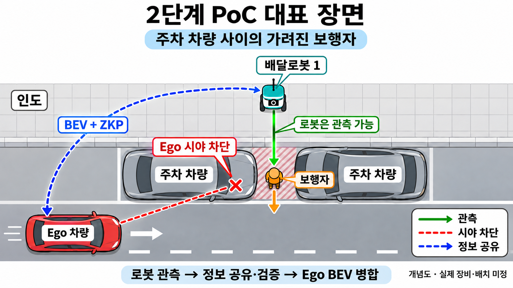

# 2단계 연구계획: 실물 협력 인지 PoC

갱신: 2026-11-05 · 대상: 2027~2028년 · 연구계획 초안

[전체 안내](../README.md) · [2025년](2025.md) · [2026년](2026.md) · [성능지표](metrics.md)

## 공통 방향

**1단계에서 검증한 시스템을 실물 차량·로봇에 적용하고, 현실 적용 시 발생하는 성능 격차·오류·고장·공격 문제를 해결.**

- 단순 이식이 아니라, 기존 방법의 한계를 확인하고 개선 방법을 비교·검증하는 연구.
- 실험실 수준 협력 인지 PoC. 자율주행차 자체 개발·공도 실증은 범위 밖.
- 증명 범위 확장·미래예측 연계 등 기존 기능을 넘어서는 추가 연구 포함.

## 대표 PoC

**주차 차량 사이 보행자: Ego에서는 가려지지만 로봇에서는 관측 가능한 장면.**

그림 1. Ego와 관측 로봇 1대의 관계를 표시한 시연 예시. 전체 장비 구성과 구분.

1. 각 모빌리티가 카메라 입력으로 자기 중심 BEV 생성.
2. 로봇이 BEV·위치·방향·취득 시각을 증명과 함께 공유.
3. Ego가 검증·공간/시간 정렬·병합 후 보행자 존재·위치 및 미래 점유 확인.
4. 동일 장면에 오류·고장·공격을 추가해 인지 유지·대체·복귀 평가.

- **주 평가 시점:** 보행자가 차도로 나오기 전, Ego에서 아직 가려진 구간.

**구성안:**
- 협약 기준: 3종 이상·4대 이상.
- 차량 1대·배달로봇 2대·제3종 로봇 1대 제안.
- 제3종은 견마로봇 기본 후보. 대체 장비는 별도 확인.

**실물 조건·실험 순서:**
- 모빌리티별 독립 컴퓨터·카메라·네트워크 구성.
- 위치·방향·취득 시각 확보.
- 주차 차량·공격/기록 장치는 참여 대수에서 제외.
- 정지 조건부터 안전계획에 따른 이동 관측으로 확장.
- 같은 시각의 카메라·BEV·검증·대응 상태 기록.

## 서브시스템별 연구

**협약의 서브시스템 명칭 유지. 각 연구를 공통 PoC에 연결.**

| 서브시스템 | 1단계 구현·검증 | 현실 적용 시 해결할 문제 | 2단계 연구 내용 |
|---|---|---|---|
| **1. 탈중앙형 협력 인지 시스템** | - BEV·메타데이터의 Groth16 공유·검증 - 전송 중 변조 배제 - 재전송 배제 - 잘못된 증명 배제 | - 단일 호스트 → 실제 다중 PC·네트워크 전환 - 정상 등록자가 처음부터 허위 BEV·좌표를 넣는 문제 | - 실물 공유 기준선 구축 - 신뢰 경계·위협 모델 정의 - 취득 기록·좌표·처리·출력 연결의 비공개 증명 연구 - 약정 규칙 준수의 비공개 증명 연구 - 보장 범위·증명 비용·공개 정보 비교 |
| **2. 자가 기능 복원 및 대응 시스템** | - 고장 15종 - 정상 참조·규칙 기반 판별 - 불량 정보 배제 - 대체·복귀 | - 실제 장면·조명·이동 변화와 고장 구별 - 협력 정보의 불완전성 - 동시 고장 | - 품질·불확실성 기반 이상 감시 - 검증된 협력 정보의 사용 가능성 판단 - 대체 소스 선택 - 인지 유지·제한·정상 복귀 정책 연구 |
| **3. 합성 공간 지능 디지털 트윈** | - RGB+LiDAR BEV - CARLA 위치·자세 기반 정렬·병합 - 별도 미래예측 경로 | - 카메라 중심 입력 전환 - 차량·로봇 시점 차이 - 실측 위치·방향·시각 오차 - 통신 지연 | - 실물 카메라 BEV 적용 - 공간·시간 오차 공동 정합·보정 - 불확실성 기반 병합 - 미래 점유 예측 연계 - 경량화 |

**시스템 연결:**
- 3의 로컬 BEV → 1의 공유·검증 → 3의 정합·병합·예측.
- 2는 사용·배제·대체·복귀 판단.

**보안 경계:**
- 증명 생성 후 변조는 현재도 차단.
- 증명 전 허위 입력은 별도 연구 대상.
- ZKP 통과만으로 실제 관측·좌표의 정확성을 보장하지 않음.

**공통 구현:**
- 센서 보정·장치 연결·메시지 규격·시험환경·독립 정답 취득.
- 관측 BEV와 예측 BEV 구분.
- 평가 정답은 인지·정합·병합 입력에서 분리.
- RGB+LiDAR 모델에서 LiDAR만 제거할 수 없으므로 카메라 중심 모델·입력 정비 필요.

## 연차별 추진안

| 구분 | 3차년도·2027년 | 4차년도·2028년 |
|---|---|---|
| 서브시스템1 | - 실물 공유 기준선 - 위협 모델·신뢰 경계 - 제한된 증명 초기 구현 | - 증명 전 조작·복합 공격 대응 연구 - 증명 비용 최적화 - 다중 장치 검증 |
| 서브시스템2 | - 정상 변화·고장 데이터 - 이상 감시 - 대체 소스 선택 방법 | - 이동·복합 고장에서 전환·복귀 고도화 - 대응 중 인지 유지 검증 |
| 서브시스템3 | - 실물 카메라 BEV - 위치·방향·시간 정합 - 미래 점유 예측 기준 모델 | - 지연·누락·가림 조건 개선 - 장기예측·경량화 - 통합 PoC |
| 공통 | - 장비 구성·시험환경 - 기준 방법 재현 - 초기 비교 실험 | - 복합 조건 통합시험·시연 - 메타데이터 - 기술/PoC 보고서·지재권 |

## 검증 계획

| 조건 | 핵심 확인·측정 |
|---|---|
| 정상 협력 | Ego 단독 대비 가려진 보행자 인지 개선 |
| 위치·방향·시각 오류 | - 단일·복합 오차별 보행자 위치 오차(m) - 중복·허위 장애물·미탐지 - 정합 보정 효과 |
| 지연·누락·통신 단절 | - 정보 노후화 - 시간 정렬·예측 보완 효과 - 활용 한계 |
| 센서·모듈 고장 | - 이상 감지 오탐·미탐 - 대체 중 인지 성능 - 전환·복귀시간 - 정보 부족 시 경고·정지 요청 |
| 전송 중 변조·위조·재전송 | - 불량 패킷 거부·미병합 - 정상 정보 오거부율 - 공격 정보 수용률 |
| 증명 전 허위 입력 | - 기존 인증의 한계 - 추가 증명·관측 일관성 검사의 효과와 한계 |
| 미래예측 | - 예측 지평·오차·유효 생성률 - 지연·누락 보완 효과 |

- **인지 비교:** Ego 단독 / 기존 협력 / 정합 보정 추가 / 예측·고장 대응 추가.
- **보안 비교:** 무인증 / 전자서명 / 현재 Groth16 / 확장 ZKP.
- **비용 측정:** 처리시간·메모리·통신·증명 비용.

**판정:**
- 같은 입력·장비·조건에서 비교.
- 공격 거부와 인지 유지는 분리 판정.
- 독립 시험 단위·연속 탐지·오류 처리 기준 사전 확정.

**협약 목표:**
- 모빌리티 3종 이상·4대 이상.
- 시뮬레이션 처리 12초 이내.
- 탐지 70% 이상.
- 12초는 실물 주행 안전 응답시간과 구분. 실물 성능 별도 평가.

## 확정할 사항

- 장비·대수 배분·이동 방식·안전계획.
- 카메라·컴퓨터·위치/방향/시각 취득 방법·예산·일정.
- 증명 대상·신뢰 경계.
- 실물 정답·오차 허용치·탐지/대응 기준·시험 건수.
- 미래예측 목표: 협약 성능표의 **'7초 이내'**와 세부 연구내용의 **'10초 이상'** 불일치 확인 필요.
- 시뮬레이션·블록체인 연동의 목적·역할·연결 방식. 협약에는 방향만 명시.
- 현재 Groth16 직접 공유와 블록체인 구현은 별개.

## 참고 근거·연구

- **협약·회의:** 최종 협약계획서의 2단계 목표·세부 내용·성능표, [2026-10-30 교수님 회의](meetings/meeting_261030.md), 팀 PoC 논의 기반.

**서브시스템1:**
- [Hermes’ Seal, 2026](https://arxiv.org/html/2603.26343v1): 출력 조건 검증 참고.
- 실제 센서 입력·전체 모델 실행 증명과 구분.

**서브시스템2:**
- [MoME, 2025](https://rasd3.github.io/MoME/): 입력 품질 기반 선택 참고.
- [Vision-Based Runtime Monitoring, 2026](https://arxiv.org/abs/2605.13923): 운용 감시 참고.
- 다중 모빌리티 대체·복귀로의 확장 필요.

**서브시스템3:**
- [CoAnchor, 2026](https://arxiv.org/html/2608.21055v1): 위치·지연 공동 정합 참고.
- [IR-WM, 2026](https://arxiv.org/html/2510.16729v3): BEV 변화 예측 참고.
- 카메라·이종 로봇 적용과 장기예측은 별도 검증.

문헌 확인: 2026-11-04. 후보 방법이며 채택·개선 효과는 비교 실험 후 결정.
